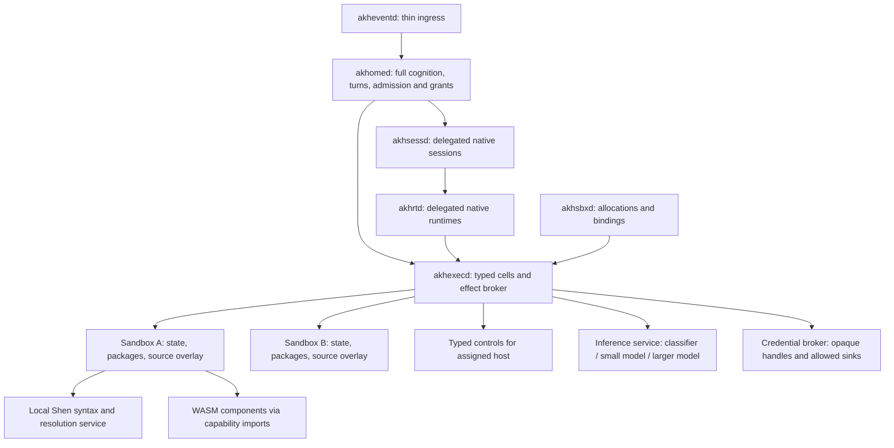

# ADR 115 — Typed execution environments and akhpack v1

> Date: 2026-09-27 (design originated 2026-09-22)
> Status: Accepted architecture; implementation pending, items remain draft.
> Approval: operator requested publication to main, Seshat and the implementation DAG on 2026-09-27.
> Anima: [Plan](https://anima.wegmueller.it/plans/01a0e25c-390c-7c61-ab5e-0fd7b910ad1f) · [ADR document](https://anima.wegmueller.it/documents/01a0e25c-3924-7271-8a23-be604ed5702a) · [plan document](https://anima.wegmueller.it/documents/01a0e25c-393b-76e1-a65e-2174f7abb29c)
> Implementation: [A0–A9 plan](../plans/2026-09-22-typed-execution-and-akhpack-v1.md), [tracker mapping](../plans/2026-09-27-adr115-tracker.json).
> Builds on: [ADR 113](113-full-akh-always.md) and [ADR 114](114-knowledge-work-codification.md).
> Supersedes: the 2026-09-22 proposal; the earlier shell-preservation suggestion is withdrawn.

## Intended outcome and fixed requirements

An Akh model works in assigned, persistent sandboxes through a typed programming
environment owned by `akhexecd`. It can discover and install WASM tools, author
parsers and event handlers, mutate permitted state, edit source through syntax
trees, and use inference services without loading the whole tool catalog or
intermediate datasets into its conversation.

The user's latest requirements supersede the earlier always-available-shell
proposal:

1. No TypeScript `any`. Types must express intent, including effects, targets,
   errors, data schemas and resource identities.
2. Remove shell-command execution entirely from the delivered execution system.
   There is no hidden shell fallback or generic process-launch replacement.
3. Native illumos execution is required. Validate on `oibuild`; a cross-build
   or a Linux/macOS pass is insufficient.
4. A sandbox-local Shen component provides source understanding and AST/CST
   editing. The model can also author parsers for other data.
5. Tools install on demand as WASM packages. Use `akhpack` v1 as a ZIP-based
   distribution contract, accessible through a VFS while still packed.
6. Sessions remain distributed across existing daemons. Models can switch among
   assigned sandboxes and hosts; host controls remain scoped tools.
7. Small models can classify events through a typed inference seam. Inference
   is available to programs. Under ADR 114, structural rules drive live
   reactions; learned decisions remain shadow-only until separately qualified.
8. Credentials can be used by programs without revealing their bytes to the
   model or its arbitrary program code.

The operator authorized architecture publication and tracker preparation only.
The hierarchy is Akh-Medu → the linked Plan → A0–A9 (WI-502–WI-511), with 19
hard internal dependency edges. WI-500 additionally depends on A1, A2 and A3.
No runtime implementation, native acceptance test or deployment is claimed.

## Decisions and compatibility with current architecture

1. Preserve ADR 113: `akhomed` retains full cognition, daemon loop, in-process
   turns, ACP, full capability registry and event admission. `akhrtd` supervises
   delegated native runtimes; `akhsessd` brokers those delegated sessions.
2. Every caller's side effects use `akhsbxd`/`akhexecd`. A small prompt-facing
   discovery/execution interface is a context policy, never a stripped Akh or
   loss of its full native capability registry.
3. Use checked TypeScript with intent-specific types and no admitted `any`;
   the runtime validates codecs, handles and permissions independently.
4. Remove shell execution from the delivered environment after typed operations
   cover the required workflows. No generic argv or provider-local workaround.
5. Keep persistent execution state in sandbox environments and use Shen for
   revision-checked source editing. Install components via verified packed VFS.
6. Keep secrets opaque. Package installation grants no new authority.
7. Preserve ADR 114 Structural/Shadow decision governance. This ADR supplies
   execution/inference mechanisms; it does not reactivate Laya/Jev dispatch.
8. Native oibuild tests gate the implementation. Every deployed Akh or daemon
   artifact must come from `origin/main` and carry its short SHA, per
   `.claude/rules/deploy-from-main.md`. The Akh always remains fully featured.

## Source inspection baseline and gaps

The following baseline was inspected on 2026-09-22 at
`b7b29a6d990c463ec64d1e934a14c84c3c4d284f`; recheck code at implementation time.
The ADR 113/114 compatibility rules above supersede older placement assumptions.

| Area | Source evidence | Required change |
| --- | --- | --- |
| Distributed services | `crates/akh-session-services/src/server.rs`, `crates/akh-session-types/src/lib.rs` | Extend existing session, runtime, executor, sandbox and event contracts. |
| Workspace confinement | `crates/akh-session-services/src/workspace.rs` uses descriptor-relative IO, rejects symlinks and carries revision checks | Preserve these checks behind a byte-oriented VFS and revision-aware source edits. |
| Legacy FS | `src/fs/mod.rs` is principally a text/path interface | Adapt to the shared VFS; do not introduce a raw-FS bypass for packages. |
| Process execution | `executor.rs` accepts shell strings through `/bin/sh -c` and literal argv; `src/agent/tools/shell_exec.rs` exposes shell execution | Retire both public arbitrary command and argv paths, including provider-local fallbacks. |
| Process test fixtures | `crates/akh-session-services/src/process.rs` tests use shell scripts | Replace fixtures with purpose-built test binaries when removing shell dependence. These matches are tests, not production shell dispatch. |
| Shen | `crates/shend` is currently a library providing Rust stack-graph resolution | Add sandbox-local syntax snapshots and transactional edits; do not claim a complete editor or polyglot daemon already exists. |
| WASM | `wit/akh-tool.wit`, `src/agent/wasm_runtime.rs`, optional Wasmtime 29 | Align WIT/runtime return types, implement host imports, add resource limits and native qualification. |
| Discovery | `src/agent/tools/tool_query.rs` lists the live registry | Add bounded search and selected export/type inspection. |
| Output volume | [WI-472](https://anima.wegmueller.it/work-items/01a0c901-36d0-7520-87f0-8b0e495f953b) covers bounded process responses | Reuse response-budget lessons; a pipeline/cursor contract remains separate. |
| Ownership analysis | [WI-420](https://anima.wegmueller.it/work-items/01a0878c-310a-7340-8ff9-e39bfec1551e) and the [agent-loop plan](https://anima.wegmueller.it/plans/01a0878b-aa4a-72d1-a8cf-7915bd279615) | Reconcile the new contract with provider execution exclusivity. |

The older tracker references identify related work, not implementation proof.
A0–A9 now have their own native Plan membership and dependency edges; see the
linked tracker mapping and plan for exact IDs.

## Placement and ownership



`akhexecd` owns cell execution, host-effect admission, cancellation and receipts.
It supervises an isolated interpreter worker for each active REPL environment;
an interpreter crash must not crash the executor or another environment. This
is an internal worker, not another session-authority daemon. The full Akh
remains in `akhomed`; the worker contains program execution, not cognition.

Every request pins session/principal, sandbox binding, binding generation,
host identity, environment ID, package-lock digest and operation ID. Selecting
another sandbox yields a new target handle for subsequent cells. An in-flight
operation stays bound to its original target. No session-global mutable cwd or
implicit transfer of grants, secrets, processes or variables accompanies a switch.
Cross-environment data transfer is an explicit, authorized artifact copy.

Separate three kinds of state:

- **Live:** variables, closures, iterators and open handles in one interpreter.
- **Durable:** schema-versioned values, source revisions, package lock, registered
  handler source and artifacts in sandbox-owned storage.
- **Execution evidence:** cell sources, checked contract versions, operation
  receipts, output cursors and incomplete/unknown outcomes.

Restart restores durable state and definitions without replaying side-effecting
cells. It does not pretend to resurrect arbitrary heap objects or closures.
Open operations with unknown outcomes require receipt reconciliation. Individual
host effects commit separately; a failed cell does not roll back an HTTP request
or a completed source edit. Transactional state updates are explicit operations.

## Language and intent expressed in types

Use a constrained TypeScript environment, compiled to JavaScript for an embedded
engine. QuickJS is the first engine candidate, conditional on the native gate.
Expose no Node, DOM, QuickJS `std`/`os`, native dynamic-library loader, raw network
socket, filesystem path escape, `eval`, or function-constructor compilation.
Dynamic execution must return through the checked cell/module admission path.

The host supplies a curated standard-library declaration set (`noLib` plus
explicit declarations), not the unrestricted TypeScript default libraries.
All admitted TS source, package glue, reachable declarations and generated
bindings must be free of `any`. The compiler implementation itself is a pinned
build dependency; it is not an admitted program or a source of ambient APIs.

Admission consists of parsing, type checking and a semantic type walk:

- Enable `strict`, `noImplicitAny`, `strictNullChecks`,
  `noUncheckedIndexedAccess`, `exactOptionalPropertyTypes`,
  `useUnknownInCatchVariables`, and checking of declaration files.
- Reject explicit **and inferred** `any`, including generic defaults, callback
  parameters, imported declarations, library return values and nested types.
  A grep or lint rule alone is insufficient.
- Reject `@ts-ignore`, `@ts-nocheck`, unchecked JavaScript imports, ambient
  declaration injection, non-null assertions and type assertions used to invent
  validated data or handles. Use checked constructors and exhaustive narrowing.
  Permit literal-preserving `as const`; it grants no authority.
- Use `unknown` only at decoding boundaries and exception capture; validate it
  into a concrete schema before operations. Do not use `unknown`, `object`, or
  generic dictionaries as universal business interfaces.
- Generate TS declarations and runtime codecs from the same versioned component
  contract. Verify WASM exports/imports against that contract before activation.
- Runtime validation and host authorization remain authoritative. Types erase
  at runtime and cannot grant capabilities.

For example, the public SDK should express edit intent this way (proposed types,
not an implemented SDK):

```ts
type Result<T, E> =
  | { readonly kind: "ok"; readonly value: T }
  | { readonly kind: "error"; readonly error: E };

interface SourceRevision { readonly sha256: string }
interface NodeRef {
  readonly document: DocumentHandle;
  readonly revision: SourceRevision;
  readonly nodeId: string;
}
type SourceEdit =
  | { readonly kind: "replace-node"; readonly target: NodeRef;
      readonly replacement: ParsedFragment }
  | { readonly kind: "insert-member"; readonly parent: NodeRef;
      readonly member: ParsedFragment; readonly position: "first" | "last" }
  | { readonly kind: "rename-symbol"; readonly symbol: ResolvedSymbolHandle;
      readonly newName: ValidatedIdentifier };

interface EditRequest {
  readonly workspace: WorkspaceHandle;
  readonly edits: readonly SourceEdit[];
  readonly expectedRevisions: readonly DocumentVersion[];
}
```

The handle and validated-value names above are host-issued SDK types; their
constructors are not exported. Runtime handle tables bind resources to the
session, target, generation and allowed operations. IDs and hashes are checked
on every effect; fabricating a structurally similar JS object does not work.
Full versioned definitions and codecs are a first implementation deliverable.

Collections and bounded async streams provide `map`, `filter`, `groupBy`, parser
and join operations. Text/bytes and formatted text responses remain supported;
shell syntax and command execution do not. Stream operations propagate upstream
errors, apply backpressure, enforce byte/item/time limits and carry cancellation.
Native regex/parsing work also needs limits; a JS instruction interrupt alone
cannot guarantee interruption inside a blocking native call.

## On-demand packages and context

The permanent REPL/discovery surface exposed in model context is small: select an assigned environment, discover
packages/exports, inspect chosen types, submit a typed cell, inspect an operation
or artifact, and cancel. Installing uses a typed package-manager API in that
environment. Installation is permitted within existing grants and budgets;
requested additional capabilities are explicit, never acquired by installation.

Use two steps when an installation changes the type environment:

1. Resolve a package to an exact archive digest, validate it and atomically
   activate a new environment lock revision.
2. Compile the next cell against that revision and import its generated typed
   exports through an `akhpack:` module specifier.

A newly discovered package does not magically create statically known types in
an already checked cell. Ongoing cells retain their pinned dependency graph.
Installed exports do not all enter the model's prompt. Host-side checking can
load declarations without sending them to the model.

## akhpack v1: constrained ZIP and verified VFS

Use a standard ZIP container with extension `.akhpack` and a versioned Akh
manifest. Do not invent a new compression algorithm or native executable loader.
The initial profile allows only regular files using Stored or Deflate methods;
reject ZIP64, encryption, multipart archives, symlinks, devices and unsupported
extra fields. Set explicit entry/count/compressed/uncompressed/ratio limits in
the versioned reader policy before implementation ships.

```text
example.akhpack
  akhpack.json           format version, package identity, runtime/ABI requirements
  integrity.json         sorted payload path, media type, size, SHA-256 inventory
  signatures/            optional detached publisher signature over inventory
  interfaces/tool.wit    typed component contract
  modules/tool.wasm      portable WASM component
  src/                  optional checked TS glue and parser/handler source
  schemas/              versioned data codecs/schemas
  docs/                 selectively retrieved descriptions and examples
  assets/               grammar/query files and other read-only data
```

`akhpack.json` declares identity/version, component entrypoints, interface world
and ABI versions, exact dependency digests, requested capabilities, resource
budgets, supported data-schema versions and host-service requirements. Capability
requests and entrypoint descriptions are typed records, not free-form permission
strings. No install scripts, shell hooks, native shared objects, compiled engine
bytecode or precompiled native WASM caches are accepted.

Integrity has two distinct identities:

- **Archive digest:** SHA-256 of the exact ZIP bytes, used by acquisition,
  content-addressed storage and dependency locks. It is external to the archive.
- **Payload inventory:** deterministic canonical JSON listing every payload file,
  including `akhpack.json`. It excludes itself and `signatures/` to avoid a
  circular hash. Signatures cover a domain-separated hash of the exact canonical
  inventory bytes. Registry policy decides which publishers are trusted; a hash
  by itself does not establish provenance or authority.

Verify the ZIP directory, payload hashes and policy before activation. Reject
duplicate names, conflicting local headers/directory entries, overlapping data
ranges, undeclared payload files and trailing executable/container ambiguity.
Use UTF-8 NFC relative paths with `/`; reject absolute paths, empty/`.`/`..`
segments, backslashes, NULs and normalization/case-fold collisions. Apply limits
while decoding, not after trusting header sizes or decompressing an entire entry.

The VFS exposes typed mount handles and relative paths, metadata, directory
listing, bounded reads and streams. A package mount is read-only and pinned to
an archive digest. Services share immutable archive blobs/indexes, while each
access still checks its own grant. Decompress only requested entries in bounded
chunks. WASM and grammar engines may require full entry bytes in memory; staying
packed means no persistent unpacked tree, not zero copying or decompression.
Deflate random access can require decoding from the start; cache bounded verified
entries and recommend Stored for large frequently accessed assets.

Writable sandbox state and source live in separate overlay mounts. Editing a
package-derived source copies that entry into the overlay with base provenance;
it never changes the installed archive. Repacking produces a new digest and
requires a new activation. State migrations are explicit typed jobs, not automatic
installation effects; retain the previous lock and compatible state snapshot for
rollback. Uninstall waits for pinned users/handlers to release the package.

No FUSE mount is required. Ordinary services use the VFS directly. A native
compiler that requires real files may materialize a bounded, declared build
input snapshot into a disposable build workspace with a receipt; that exception
does not silently unpack packages for routine service reads.

## Shen editing and parser authoring

Reuse Shen's resolution library inside a sandbox-local service/worker and bind
it to the sandbox VFS. Keep the central code graph as a derived read model.
This extends ADR 057: staged edits now have an explicit local syntax revision
outside the model context; they do not become belief-KG assertions.

The edit sequence is parse/open → query definitions/nodes → construct typed
edit → preview → commit with expected revisions → reparse → diagnostics.
Tree-sitter provides a concrete syntax tree; preserve comments, trivia and
untouched bytes. Parsing success is not semantic correctness. Rename requires
proven resolution for affected references; incomplete coverage returns a typed
unsupported/unresolved result rather than a guessed global replacement.

Nodes are valid only for their content hash and parser version. Stage multi-file
edits against one workspace revision under the executor's writer protocol.
Journal prepared/new/committed state, fence concurrent writers and make recovery
explicit. Atomic overlay-root publication can give VFS readers one revision;
do not claim that sequential host-file renames are a cross-file atomic commit
for external tools. Native builds consume a pinned snapshot.

First editing languages: Rust plus TypeScript for the REPL/package sources.
Additional language support declares separate parse, query, structural-edit and
semantic-refactor capabilities. Unsupported languages remain readable and can
be created/replaced through explicit revision-checked document operations; no
shell text-processing fallback is provided.

Model-authored parsers run as checked TS or installed WASM with schemas, bounded
inputs and fixtures. Parser tests include malformed data and resource exhaustion.
Registering a new parser does not grant write, network, secret or process access.

## Secrets, models and events

Credential handles are host objects with no plaintext read/string/JSON conversion.
The credential broker performs approved authentication/signing operations at
scoped sinks and controls redirects, destination identity, logging and receipts.
Do not inject secrets into guest strings, environment variables, WASM memory or
model-authored parsers. Protected transforms can return protected handles; release
to public data requires a separate explicit policy. Destination/response design
must account for servers that echo credentials; arbitrary plaintext transforms
cannot provide a no-disclosure guarantee.

Inference has typed input/output schemas, model/capability selection, deadline,
call/token budget, allowed data labels and provenance. A small-model result is
validated shadow data for learned dispatch decisions under ADR 114. Structural
rules remain the live chooser; qualification is per decision family under a
separate decision. A model output grants no permissions. Event registrations
are admitted by the full Akh trigger/reactor system and pin handler
source, schema, package lock, target binding and grants. Durable event IDs,
deduplication, bounded retries, recursion limits, concurrency limits and
backpressure prevent a classifier reaction from creating an unbounded loop.
Unknown external effects are reconciled rather than replayed. A structurally admitted reaction can emit a result, run an already-authorized
operation or request a larger-model turn. `akheventd` forwards ingress; it does
not take admission away from `akhomed`.

## Shell removal and typed replacements

Remove `shell_exec`, arbitrary `exec_start(command)`, arbitrary `exec_start(argv)`,
remote shell execution and provider-native shell escapes. Validate the actual
provider tool inventory before admitting a session. An incompatible provider is
unsupported until it can honor this contract; never silently weaken the mode.

Replace use cases with intent-specific APIs: VFS read/search/write, Shen edits,
repository inspect/diff/commit, package operations, diagnostics/test/build jobs,
HTTP with typed destinations, artifact transfer and typed host controls.
Repository jobs must not execute repository hooks or configurable shell aliases.
Host controls do not accept script bodies or arbitrary executable paths.

Native build tools may be invoked only by fixed, host-owned adapters with typed
requests and constrained descendants. Literal argv alone does not make a tool
safe: compilers, build scripts, Git hooks, helpers and provider extensions can
spawn a shell. Shell-spawning workflows must be replaced or reported unsupported.
There is no exemption that reintroduces shell execution through a build adapter.
The implementation must prove enforceable descendant restrictions on illumos;
an allowlist of the initial executable is not sufficient. General Cargo/make
compatibility under this rule is an explicit feasibility risk and release gate.

The shell prohibition concerns the delivered Akh execution environment. Operator
transport used to build/test the implementation on `oibuild` is test infrastructure,
not a shell capability exposed to the model. Acceptance records must distinguish
those processes from descendants of the system under test.

## Native portability and open engineering decisions

QuickJS embedding, the pinned TS checker/transpiler and its curated declarations,
Wasmtime/component bindings, ZIP/VFS IO, tree-sitter and worker isolation must all
execute on `oibuild`. Current Wasmtime documentation mentions illumos as less
tested; that does not establish compatibility of this repository's Wasmtime 29
feature set. QuickJS's installation documentation does not establish an illumos
build. Neither dependency is approved solely from documentation.

Qualify pinned versions before committing to the engine. If a version upgrade or
port is needed, record it as an explicit dependency change. Do not silently fall
back to a different WASM ABI or remove the no-shell restriction. Engine bytecode
and compiled WASM caches are local disposable artifacts, keyed by engine version,
target and source digest, never trusted distribution inputs.

Pending implementation decisions: exact compiler/engine versions, curated TS
library coverage, archive quotas and signature trust roots, enforced native-build
isolation on illumos, and multi-writer workspace publication mechanics. These
are bounded tasks in the plan, not claims that the feature already works.

## Alternatives and consequences

- Keeping shell as a fallback contradicts the fixed requirement; replace its
  necessary workflows with typed operations and surface unsupported cases.
- A JavaScript-only runtime with declarations but no admission checking cannot
  enforce the no-any rule. Compile/check before execution and validate at the host.
- Extract-on-install packages create mutable trees and duplicate service state.
  Immutable VFS mounts preserve package identity; writable overlays are explicit.
- A new workflow DSL would duplicate the typed cell language and ADR 114's
  codification work. Use typed functions, bounded streams and existing reactors.
- Types are not execution authority. The host remains responsible for grants,
  opaque resources, budgets, target fencing and durable receipts.
- Shell removal affects provider/toolchain compatibility. A0 and A7 must expose
  feasibility limits before A8 cutover; full-Akh functionality cannot be replaced
  with a reduced deployment to make the migration pass.

## External references

- [Tobi's execution-environment post](https://x.com/tobi/status/2101832189469929494)
  motivated persistent composition; the user's later no-shell requirement is
  authoritative for this ADR.
- [TypeScript noImplicitAny](https://www.typescriptlang.org/tsconfig/noImplicitAny.html):
  inference checking is only part of the required admission gate.
- [QuickJS manual](https://bellard.org/quickjs/quickjs.html): embedding, runtime
  limits and host integration candidates; native illumos proof remains required.
- [Wasmtime platform support](https://docs.wasmtime.dev/stability-platform-support.html):
  platform guidance, not a test result for this checkout's pinned dependency.

References checked 2026-09-22. No runtime or performance claims are made by this document.
