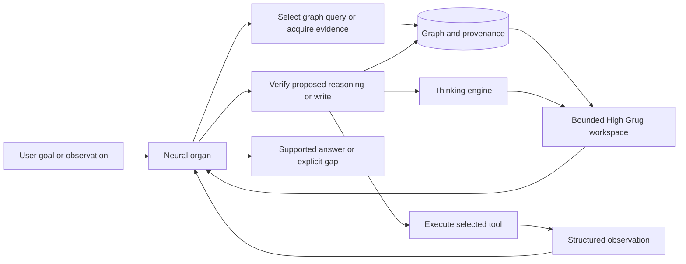

# Akh release one: grounded reasoning, Dojo, persistent learning and action

Date: 2026-09-11. Updated with the user's Dojo, emotional-intelligence, Portuguese-basics and unfamiliar-homelab requirements. Status: integrated proposal; no new training or deployment launched. Deployment target: Apple Silicon Mac mini with 16 GB unified memory; exact chip and macOS version remain to be recorded on that machine. The filename retains the original 350M reference for stable links; the candidate range is now 350M–1.1B.

## Objective and requirements

Deliver an Akh that understands a goal, acquires and maintains knowledge in its graph, reasons over that knowledge, selects tools, observes their results, repairs its plan and interaction, and completes the task. Start with a roughly 350M general reasoning model; 0.5B and 1.1B are explicitly acceptable candidates. Success is demonstrated by the integrated Akh's behavior across unfamiliar situations, including learning new commands at runtime.

The user explicitly prioritizes functional completeness and generalization over minimizing parameter count. This supersedes the narrower knowledge/notes-assistant recommendation in the September 11 tool-calling assessment. The 33.4M recovery checkpoint remains an experimental control. Passing its isolated tool exams remains useful regression evidence, but does not establish Akh competence.

The three central hypotheses are:

1. Weights can supply transferable comprehension, reasoning procedures and tool-use reflexes while new, changing, attributable knowledge lives in the graph.
2. High Grug can preserve the evidence needed for decisions in a compact, typed, executable register, improving useful work per unit of context or compute.
3. A 350M–1.1B organ combined with graph retrieval, iterative engine reasoning and practiced Dojo skills can perform the Akh function on the target Mac.

All three need direct tests. A successful optimizer run, plausible explanation, valid tool envelope or large parameter count cannot establish them.

This document is the coordinating plan for [High Grug](../decisions/092-high-grug-v1-reasoning-register.md), [dual-process reasoning](../decisions/093-dual-process-trace-handoff.md), the [Dojo manual including its extended forms](../manuals/2026-09-01-babyllm-dojo-curriculum.md), [communicative intelligence](../decisions/099-agentic-communicative-intelligence.md), [Portuguese acquisition](2026-09-10-portuguese-language-stage.md), and the [unfamiliar-homelab release exam](2026-09-11-akh-homelab-release-exam.md). The earlier documents retain their detailed designs and historical results. This update changes their ordering: broad Portuguese adaptation is no longer a prerequisite for consultation training, and all action, memory and social skills enter the integrated evaluation from the beginning.

Release one may be an evaluated model with uneven capabilities and an explicit assistance profile. Preserve the full test suite and publishable failure analysis in its candidate bundle so a partial result advances the intended architecture. The stronger full-autonomy targets below remain visible. A research candidate with documented failures does not acquire an active-model certification, silently pass an old gate, or gain unattended write access by being called R1. No benchmark score is claimed by this plan.

| Priority | R1 commitment |
|---|---|
| Central capability | Grounded reasoning, graph acquisition/revision/recall, novel command learning, Unix-style composition, real action verification, and memory-to-action transfer. |
| Central behavioral curriculum | Eight starter kata, extended process consultation, correction and repair, emotional intelligence expressed in action, and selection of an appropriate practiced form. |
| Measured basic coverage | Understand simple Portuguese goals, negation, clarification and corrections while preserving identifiers. Report limitations; full Portuguese fluency is optional for R1. |
| Full-plan capability with separate evidence | Perception/OCR to graph to action; retain the existing multimodal gates and report progress separately. |
| Stretch learning experiment | Black-belt transmission: does an independently trained student learn a skill faster from the model's evidence-backed lessons? |

Model size, corpus proportions and quantization are experiment variables. Functional completeness is the direction of travel; demonstrated limits are acceptable results and must shape the next experiment.

## Starting evidence and reusable components

| Asset | Evidence available | Limit on the conclusion |
|---|---|---|
| Current 33.4M recovery candidate, step 493261 | Saved checkpoint; knowledge exams 800/800, tool exams 1257/1272; three blocking families | Uncertified. These generated exams do not prove autonomous graph use or broad generalization. |
| Earlier 341.9M rule model | Recorded in-distribution answer accuracy 0.928 and chain score 0.935; unseen-depth chain score 0.000 | Synthetic DSL, 355 effective vocabulary entries, 1024 context. Useful reasoning reference, not a general-language foundation. |
| High Grug v2 | Accepted typed slots, governed operators, token-ID parsing, engine-checkable traces | Entity-token promotion and VSA projection remain deferred. Compression and transfer still require workload measurements. |
| Dual-process handoff | Recorded synthetic and engine-handoff experiments with valid prefix salvage | Existing engine experiment uses prepared traces and simplified goals. It does not establish a complete live model/graph feedback loop. |
| Production graph tools | Memory write/recall, graph query/mutation, reasoning, schema discovery and tool discovery exist | Integration must measure entity identity, revision, evidence attribution and actual subsequent use. |
| Tool-call runtime | Catalog retrieval and repair exist; new local required-argument fix is commit `659101db17a613e2768091f7cca79cd6fef78fb3` | Fix passed 290 library tests, one ignored; no model evaluation or remote deployment yet. Repair effectiveness must be reported separately from raw model competence. |

Sources: [ADR 092](../decisions/092-high-grug-v1-reasoning-register.md), [ADR 093](../decisions/093-dual-process-trace-handoff.md), [350M results](../../../training/results/p350m-RESULT.md), [350M model card](../../../training/hf/grug-rule-350m-README.md), [current run analysis](../../../runs/babyllm-recovery-20260909/release-v3-failure-analysis.md).

The old results show a failure to generalize depth under the tested curriculum. They do not prove that no larger model or different curriculum can generalize. Test controlled iteration and composition explicitly.

## Division of responsibility

| Component | Responsibility |
|---|---|
| Neural organ | Interpret goals and evidence; form subgoals; identify information gaps; choose queries, inference steps and actions; extract proposed facts; interpret observations; revise a plan; explain supported conclusions. |
| Graph and provenance store | Persist entities, relations, source evidence, episodes, validity/revision state and derived-fact dependencies. Resolve identity across sessions. Distinguish observations, claims and derived conclusions. |
| High Grug workspace | Carry typed entity bindings, facts, goals and licensed inference steps between the organ and engine. Preserve links to underlying evidence. |
| Thinking engine and verifier | Check proposed steps, execute supported inference, return conclusions or gaps, enforce budgets and record which work was supplied by the engine. |
| Tool runtime | Expose discoverable schemas; serialize calls; validate arguments and references; execute the selected action; return structured results and errors. |

Proposed operating loop:

The host may simplify representation by resolving short references, supplying schemas and constructing JSON. It must not secretly choose the correct tool, supply the benchmark answer, or reconstruct omitted semantic facts. The model must demonstrate selection and extraction. Report any engine completion or argument repair in the execution ledger.

Do not require a tool call for ordinary conversation. Conversely, requesting an action must not silently succeed as prose: completion needs the tool's actual receipt. Model-generated confidence is not a substitute for evidence validation.

## Model and deployment choice

Use a general-language configuration in a 350M → approximately 0.5B → approximately 1.1B capacity comparison, with enough vocabulary for the required languages and a stable High Grug token region. The existing `akh_tool_350m_8k` preset is a starting architecture: 24 layers, width 1024, 16 attention heads. Recount parameters after choosing the real vocabulary; the preset name is not the parameter count. Larger configurations require explicit architecture manifests. Pilot progressively; do not fund three complete foundation runs just to fill a table. Select by unfamiliar-task capability, retention and measured Mac cost rather than smallest size or longest training.

Inventory owned foundation artifacts before choosing initialization. Neither expanding the 33.4M checkpoint nor changing the narrow 341.9M model's tokenizer is a valid drop-in resume. A new tokenizer, positional scheme or architecture requires an explicit transfer experiment or new training lineage. Retain the sovereign, locally reproducible training recipe from ADR 092; an external open-weight model can be a diagnostic comparison without becoming the shipped foundation.

A 350M model has approximately 0.65 GiB of FP16 weights, before runtime overhead. For the proposed 24-layer, width-1024 full-attention shape, a batch-one FP16 KV cache is approximately 0.75 GiB at 8192 tokens: `2 × layers × context × width × 2 bytes`. These are arithmetic estimates, not measured application memory. The graph, indexes, inference scratch space, other organs and macOS also consume memory.

Start inference validation in FP16, then compare 8-bit, affine 4-bit and floating-point 4-bit on the best candidates. Raw weight payload estimates in decimal GB are 0.70/1.00/2.20 for FP16 at 350M/0.5B/1.1B, and 0.175/0.250/0.550 for four bits per weight. Scale metadata, unquantized tensors, KV caches, graph/index memory and runtime allocations are additional. Share base weights across the six Ennead profiles, with bounded per-session caches and optional adapters, instead of six independent model copies. Use graph retrieval to select working evidence; expanding context does not replace persistent memory.

FP4 is a concrete experiment: current [MLX quantization documentation](https://ml-explore.github.io/mlx/build/html/python/_autosummary/mlx.core.quantize.html) distinguishes `mxfp4`, `nvfp4` and affine integer quantization, and the [MLX v0.29.0 release](https://github.com/ml-explore/mlx/releases/tag/v0.29.0) records MXFP4 support on Metal and CPU. Pin the actual backend version and benchmark it on the target chip. Four-bit storage does not establish four-bit arithmetic for every operation or a particular speedup. Train initially with the supported stable precision; quantization-aware adaptation is a separate option if post-training quantization loses important skills. Use a separate calibration set and rerun command composition, graph revision, reasoning and Dojo after conversion.

MLX is a deployment candidate, not an already completed port. The current verified BabyLLM runtime uses Burn and a custom transformer/checkpoint format. A faithful MLX implementation needs weight export, matching normalization/attention/position semantics, the identical tokenizer, High Grug and tool constraints, and parity checks. First compare CPU/Burn and MLX on logits within stated numeric tolerances, deterministic decoded actions, executable traces and complete episodes. Re-run certification on the shipped backend and precision. [MLX LM supports generation, fine-tuning, quantization and cache controls](https://github.com/ml-explore/mlx-lm); this does not establish support for our custom architecture.

Proposed Mac targets: total Akh resident working set at most 10 GiB under the declared concurrency profile, leaving headroom for macOS; no sustained swap growth in a 90-minute workload; warm first actionable response p95 at most 5 seconds at a 2k prompt and 10 seconds at 8k, excluding external tool latency. Record cold start, prefill, tokens/second, complete-task latency, graph-query latency and energy separately. These are initial engineering targets to test on the actual 16 GB Mac, not performance claims. If capacity needs grow, evaluate a larger candidate against the same workload before cutting Akh functions.

## The release exam: complete episodes with persistent state

Build an episode harness around the real Akh graph and tool interfaces in isolated workspaces. Use deterministic local fixtures for external services, without replacing graph operations with canned answers. Each episode has an initial graph, user inputs, environment transitions, permissible outcomes, expected final graph changes and supporting evidence. The scorer can see ground truth; the runtime cannot.

The initial development pack contains 100 episodes spanning all twelve families below. The full-autonomy release pack contains at least 100 independently generated worlds per family, with at least 200 learn/restart/recall episodes across the pack. A smaller R1 pilot reports its actual sample sizes and cannot borrow the larger pack's confidence. Separate development, validation and sealed release worlds by generator structure, entity sets, documents and workflow compositions. Repeated paraphrases of one world do not count as independent evidence.

| Family | Required behavior and evidence |
|---|---|
| Acquisition | Read unfamiliar material, extract distinct facts, preserve source spans and identity, and persist the intended graph delta. |
| Persistent recall | Clear conversation/KV state, restart the Akh, and answer or act using facts learned in an earlier session. |
| Grounded reasoning | Join facts from multiple sources, select/bind/apply rules, expose verifiable intermediate steps and handle longer unfamiliar compositions. |
| Knowledge revision | Distinguish new observations from contradictions; update validity, preserve history, and reconsider dependent conclusions. Repetition must not create duplicate entities or facts. |
| Tool choice | Discover the appropriate capability, select among near-neighbor schemas, bind exact evidence-backed arguments and verify the result. |
| Multi-step work | Combine acquisition, graph lookup, inference, writing and external action; finish the requested task without an oracle-provided sequence. |
| Novelty and ambiguity | Handle unfamiliar entities, descriptions and schema combinations; request clarification or more evidence where genuinely necessary. |
| Language transfer | Exercise English, German and French paraphrases and cross-language identity. Include a separately scored Portuguese-basics slice for simple requests, negation, clarification and corrections; broader fluency remains optional. |
| Recovery and durability | Resume after a failed tool, interrupted process or stale observation; avoid duplicate side effects and preserve the graph across restart. |
| Perception to knowledge | For document/image workflows, connect visual/OCR evidence to graph claims and later actions; test transcription and downstream reasoning separately and together. |
| Dojo under operational pressure | Apply, combine or decline a kata during a task; handle uncertainty, disagreement and explicit correction; measure resulting actions and retained participant ownership. |
| Runtime command learning | Start without site knowledge or a new command's semantics; discover docs, store a versioned capability in the graph, compose a working pipeline, and reuse or revise that knowledge after restart. |

The perception-to-knowledge family remains a required integration milestone in the full plan. First debug the same episodes with verified text transcripts, then substitute actual visual observations and run the existing multimodal/cross-host gates. Text success is an intermediate result, not a relabeling of the complete release.

A representative acceptance episode: read a new maintenance note and record equipment dependencies with source references; restart; receive a task whose correct tool and timing depend on those dependencies; query and reason over the graph; receive a correction to one dependency; revise the belief and dependent plan; execute the newly appropriate action once; explain the result with evidence. Randomize names, relations, tools and narrative form across held-out worlds.

The flagship exam makes the Akh the alert-driven homelab caretaker in a disposable local lab. It starts with a goal, its actual delegated role, an alert and access to discoverable utilities; topology, resource identities and unfamiliar commands must be learned. Give it tasks involving stalled backups, capacity pressure, stale monitors, dependency failures and a changed CLI. The [exam specification](2026-09-11-akh-homelab-release-exam.md) defines environment isolation, acquisition/reuse/version-change phases, observations, paired emotional contexts and scoring. These are candidate evaluation tasks; no production homelab command is executed by authoring them.

## Experiments that can falsify the architecture

Use matched tasks and equal evidence access. Begin with cheap development subsets and expand only promising arms; avoid a full Cartesian product of models and variants.

| Comparison | Question and required measurement |
|---|---|
| Frozen weights, changed graph | After ingestion, correction and restart, do answers and selected actions follow current supported graph state? Remove the relevant edge and require a gap instead of confident recall. |
| Graph available vs unavailable vs changed | Does task resolution depend causally on external facts? Use coherent counterfactual graphs to test answer sensitivity, and separately broken provenance/reference variants to test rejection. Score appropriate abstention separately from successful resolution. |
| Plain-text evidence vs High Grug | At equal information and total compute budget, compare episode success, evidence fidelity, context tokens and total model/engine/tool cost. Count binding tables, glosses and retries too. |
| Bare vs typed slots | Does typing reduce wrong relation/entity binding on ambiguous and open-world examples? Retain the accepted type contract; measure its benefit rather than assuming it. |
| One model pass vs iterative model/engine feedback | Can the organ consume an engine result, revise its next proposal and finish unseen compositions? Include a feedback-disabled arm and charge both substrates' costs. |
| Model-assisted vs engine-only | Does the organ contribute useful selection, interpretation or faster completion? Prevent the host from solving every task while the model merely formats the answer. |
| Automatic vs oracle retrieval | Diagnose retrieval misses separately from reasoning failures. Oracle retrieval is a labeled diagnostic condition, never a release score. |
| Raw vs constrained/repaired calls | Distinguish learned selection and extraction from syntactic assistance; measure tool correctness, missing facts, retries and action outcomes. |
| Existing small vs primary 350M candidate | Test whether additional capacity improves unfamiliar-world performance under comparable curricula. Separate matched-data and matched-compute comparisons. |
| 350M vs 0.5B vs 1.1B | Separate capacity from pretraining differences; compare compatible curricula and report any incomparable base-model provenance. Measure generalization gains, not just familiar-example loss. |
| Command documentation + KG vs documentation without persistence | With weights frozen, compare initial learning and post-restart reuse. Remove the command's KG record to test whether reuse depends on it; change CLI version to test revision. |
| Dojo-aware vs plain task training | Compare technically matched episodes under distinct expressed needs, including correction of the model's first interpretation. Score changes in behavior, decision ownership and task success. |

Counterfactual worlds must include randomly assigned facts unavailable from pretraining, entity renaming and contradictions with familiar stereotypes. Keep weights and adapters fixed during persistent-memory tests. Clear transcript summaries as well as KV state on cold recall, so a hidden conversation cache cannot masquerade as a graph.

Pre-register proposed full-autonomy targets: at least 90% complete-episode success overall and 85% in every family; at least 99% precision of accepted graph assertions and 95% recall of required facts; at least 95% successful cold recall and revision behavior; at least 99% grounded support for material answer claims. Correct abstention counts as success only when the episode actually lacks the necessary evidence. A model that always abstains fails resolvable tasks. R1 candidate reports show raw performance and the assistance needed even when below these targets; preserve unsolved tasks and failure causes instead of shrinking the exam. Any enabled operational profile remains bound to its actual certification evidence.

Keep the existing 61-family certification thresholds intact. Add zero observed destructive/wrong-target actions or fabricated source attribution in the new release pack. Report counts and confidence intervals by independent world and critical action; zero failures in a finite sample is not a zero-risk guarantee. Report assertion precision with assertion recall to expose avoidance of writes, and retain all failed episodes.

For the High Grug hypothesis, propose non-inferiority within two percentage points of the plain-text arm's episode success and at least a 25% reduction in working-context tokens at equal evidence, or a separately demonstrated reduction in complete-task cost. Use paired uncertainty estimates; an inconclusive result remains inconclusive. Failure prompts a register/curriculum diagnosis, not a claim that compression worked. Causal graph interventions and iteration comparisons must show the expected behavior changes, rather than only a higher aggregate score.

## Curriculum: learn procedures and their conditions of use

First provide adequate multilingual comprehension, then interleave High Grug fluency, grounded reasoning and complete interaction trajectories. Preserve replay of comprehension and already learned capabilities during later training. Choose mixture proportions from held-out learning curves; do not simply enlarge the existing single-call corpus.

Teach the full sequence `observe → query → reason → act → inspect result → revise → persist → recall`. Include failed queries, ambiguous identities, tool errors, new evidence, contradictory sources, stale data and correctly justified gaps. Train graph writes as semantic extraction and entity resolution, with validators rejecting unsupported proposals; copying a prevalidated host object alone does not exercise that skill.

Use engine-generated worlds for exact supervision and independently authored documents/tasks for transfer. Vary graph topology, causal and temporal structure, depth, distractors, source reliability and tool descriptions. Hold out compositions and generation mechanisms, not only strings. Never train on the existing frozen release failures or the new sealed release worlds; generate distinct practice material from diagnosed failure categories.

High Grug training follows ADR 092's closed operator vocabulary and positional slots. Retain source references at the boundary and teach gloss/trace correspondence. Revision must be measured through the graph's existing operations now; adding explicit contradiction/retraction operators to the register requires a versioned corpus and replay semantics because ADR 092 deferred them. Do not assume all knowledge can be losslessly compressed into triples: retain original text/images and uncertainty where the graph representation is incomplete.

Reflexes are reusable procedures with applicability conditions: when to retrieve, how to compare evidence, how to bind a schema and when to stop. New workspace facts enter the graph immediately through verified writes. Any later consolidation into adapters/weights is a separate, versioned offline experiment, with regression and provenance checks. Test whether a previously useful reflex is overridden when current evidence makes it inappropriate.

Only consider executable-reward optimization after the episode harness detects shortcuts, unsupported writes and repeated side effects. Grammar acceptance and final-answer resemblance are insufficient rewards.

## Dojo and extended practice: memory becomes action

Use the [existing manual](../manuals/2026-09-01-babyllm-dojo-curriculum.md) as the detailed curriculum. All eight starter forms enter integrated tasks: Yes-And, The Mirror, Redirect-Refusal, Stubborn Affirmation, Double Diamond, Clarify-Before-Answer, The Silence, and Naming-the-Move. Preserve the correction in Yes-And, keep alternatives genuine in Double Diamond, ask only decision-relevant questions, and do not force humor or affirmation into an incident. Grade the structural effect and subsequent action, without language-specific phrase matchers.

Bring in all six extended consultation forms: Establish the Working Agreement; Observe and Inquire; Hold Competing Explanations; Make a Small Intervention; Read the Response and Repair; Return Ownership and Learning. Their common loop is observation, provisional explanations, a proportionate move, feedback and revision. A process-consultation exercise and an infrastructure diagnosis both test whether new evidence changes the next action, while retaining their distinct social and technical scorers.

| Belt | Memory-to-action exercise | Transfer evidence |
|---|---|---|
| White | Practice a single grounded form: retrieve a fact or command contract, apply one move and check its immediate effect. | Same function under different phrasing, names and values. |
| Yellow | Vary language, resource names, context budget and command output while retaining the practiced function. | Cross-language and unfamiliar-surface success without exact-template copying. |
| Green | Spar with misleading first hypotheses, failed commands, pressure to act, limited context and participant corrections. | Evidence-backed repair; no repeating a broken action behind an apology. |
| Brown | Select and compose forms, retrieval, reasoning and Unix operations; recognize when no intervention is needed. | Complete unfamiliar episodes, including command discovery and cold graph recall. |
| Black | Extract a conditional, evidenced lesson from an episode and transmit it to a new learner. | A held-out student experiment improves learning or transfer, rather than merely producing convincing commentary. |

The existing eight voice slots remain distinct from the six Ennead agents; unnamed/private lineage content is not invented. Preserve the engine-side communication-strategy and adapter selector required by [ADR 099](../decisions/099-agentic-communicative-intelligence.md). The organ still chooses task queries and tools from runtime-visible evidence. A model-selected communication/adapter arm is a separately labeled Brown-belt experiment with explicit access to the state needed for selection, not a silent replacement of that design.

High Grug must also express the kata decision and observed effect. Use versioned labels and typed records linked to the governed register; do not add unsupported operators or pretend a factual proof checker can establish a person's emotional state. Preserve `{situation, move_chosen, why_this_move, observed_effect}` with evidence references. The next observation is available only after the move. Keep future reactions and judge labels out of earlier inputs.

Proposed extended practice includes spaced retrieval across restarts, interleaving operational and social tasks, counterfactual variations, gradually removing demonstrations, and explicit correction followed by another attempt. These are training experiments, not claims that a human learning mechanism automatically transfers to a transformer. Graph-stored skills carry purpose, prerequisites, command/version or schema bindings, tested examples, evidence, failure cases and invalidation conditions. Contrast successful reuse with rote repetition when those conditions change.

Train retrieval and execution of new skills through KG entries while weights stay fixed. A later offline consolidation arm can distill verified procedures into adapters, but it must preserve conditional applicability and the distinction between a general procedure and one site's facts. Compare immediate KG learning, later weight consolidation, and no-consolidation retention separately.

## Emotional intelligence and Portuguese basics

Emotional intelligence is observable adaptation to the person and situation: understand an expressed need, keep inferred needs tentative, choose useful help, accept a correction and repair the actual behavior. Include paired homelab episodes where the same repeated status request means insufficient visibility, a wish to participate in decisions, or a request to keep already-delegated execution moving. The correct next action differs. Do not override explicit preferences because of an inferred emotion, infer fixed personality labels from a single exchange, or grade gratitude as success.

Use deterministic action/authority receipts plus rotating, blinded judges for inquiry relevance, supported interpretation, fit of intervention, correction uptake and ownership. Include independent cases and review disagreement. Synthetic reactions remain simulation evidence. Practical success and social success are scored separately, then together: a technically correct fix can still disregard the working agreement, and warm words can accompany a failed repair. Exercise these forms beyond incidents in ordinary planning, teaching and consultation so they generalize across domains.

Portuguese has a modest R1 target: understand a simple goal or alert, distinguish negation and conditions, ask a useful clarification, accept a correction, retrieve/store a basic fact and preserve command names, paths, numbers and flags. Cover PT-BR first as in the [acquisition plan](2026-09-10-portuguese-language-stage.md), with PT-PT basics labeled separately; report comprehension and generation independently. Fluent long-form output and specialized Portuguese reasoning are optional. Prepare a bounded source sample and natural task episodes, audit accents/token efficiency and retain English/German/French skills. Dojo/consultation proceeds in the supported languages even if the broader Portuguese stage is delayed.

## Execution order and decision points

| Stage | Dependency | Concrete deliverable and exit condition |
|---|---|---|
| A — Freeze the functional contract | This requirements correction | Episode schema, twelve-family development pack, homelab/unknown-command fixtures, Dojo rubrics, graph-delta scorer, declared budgets and sealed-set procedure. Existing checkpoints and failed results remain intact. |
| B — Audit the working loop | A | Trace one real Akh alert-to-action episode across model, graph, verifier and tools, with command discovery, cold recall and an operator correction; identify missing paths and independently measure fixes. |
| C — Establish capacity and representation controls | A, B | Evaluate retained models where compatible; inventory a suitable general foundation; optional open-weight diagnostic; paired plain-text/High Grug and retrieval/iteration results. |
| D — Validate capacity and Mac inference feasibility | C | Progressive 350M/0.5B/1.1B pilots as evidence and budget justify; throughput, peak memory and cost; FP16 parity plus measured 8-bit/affine-4-bit/FP4 tradeoffs. |
| E — Train the integrated candidate | C, D | Interleaved comprehension, graph, command-learning and Dojo curriculum, with Portuguese basics; capability-curve checkpoint selection and unfamiliar-episode transfer. |
| F — Complete perception and full release evaluation | E | Native perception-to-graph episodes, unchanged tool/knowledge gates, new episode suite, and all cross-host checks pass on the exact candidate/backend. |
| G — Package and validate the Akh | F for full operational certification; completed pilot evaluation for a research candidate | Reproducible bundle, capability/assistance profile, retained failures, restart/restore and endurance evidence on the 16 GB Mac. Any active installation uses existing certification gates. |

The next implementation slice is A plus a single instrumented B episode: an alert arrives in an unfamiliar disposable homelab; the Akh discovers a command, learns its contract into the graph, composes a diagnostic pipeline, acts on the result, handles a participant correction, verifies recovery and successfully reuses the learned command after restart. This is the first executable integration target. Expand its unseen variants before buying a large training run.

Do not interpret the historical 8k preset as proof that 350M training at that length fits. The source records that even the small model's 8k foundation training exceeded the A100's memory under one autodiff configuration. Benchmark representative length/batch/precision, checkpointing and efficient attention before fixing the training schedule. MLX inference feasibility on 16 GB and full-model training feasibility are different measurements.

Budget evidence from 15:14 UTC on September 11 showed $78.23 account credit and approximately $0.70/day of retained storage baseline. Those are timestamped observations, not a new project allocation or a fresh balance. The prior $10–15 experiment ceiling was a proposal, not a complete 350M budget. Prefer local harness work and existing evidence first. Propose a $10 ceiling for a subsequent diagnostic compute tranche; commit only after its concrete run manifest, available credit and measured throughput are known. No compute is launched by this document.

For each candidate recipe, estimate cost from measured `training tokens / tokens per second / 3600 × hourly rate`, then add evaluation, retries, checkpoint transfer/storage and headroom. The old narrow 350M run's approximately $30 cost does not price broad language foundation training. Stop training on validation regression, flat capability curves over two scheduled evaluations, numerical instability or the declared cost cap; preserve resumable state. Select the best complete-episode checkpoint rather than automatically selecting the last one.

## Implementation seams and research context

Use existing interfaces before adding parallel implementations:

- Graph and memory: `src/agent/tools/{memory_write,memory_recall,kg_query,kg_mutate,kg_delete}.rs`, provenance and graph truth-maintenance code. Inspect how revisions propagate before promising automatic dependent-fact invalidation.
- Reasoning: `crates/grug-data/src/reason/{register,replay,handoff}.rs`, `reason/rule/`, `examples/phase51_p6_engine_handoff.rs`, and the live thinking engine. Verify the reverse engine-to-model feedback path explicitly.
- Serving and training: `crates/grug-train/src/{transformer,knowledge_runtime,knowledge_train}.rs`; `src/agent/organ.rs` for scoped tools and repair; preserve candidate-versus-active artifact checks.
- New artifacts proposed: `training/akh-episodes/` for schemas and split manifests, an episode runner linked to the real engine, and a backend-parity report. These files are not implemented by this plan.

[ReAct](https://arxiv.org/abs/2210.03629) supplies evidence for interleaving reasoning, action and observations. [HippoRAG](https://arxiv.org/abs/2405.14831) supplies evidence for graph-assisted integration and retrieval of new knowledge. Neither establishes our model size, graph-write correctness or High Grug benefit; those are our experiments.

[SmolLM2-360M](https://huggingface.co/HuggingFaceTB/SmolLM2-360M-Instruct) is a useful same-scale general-language diagnostic reference. Its card records extensive pretraining and mainly English capability; it specifically attributes function-calling support to the 1.7B variant. Do not assume the 360M model already solves Akh tool use or multilingual requirements, and do not treat its recipe as affordable from the current credit. An external baseline is a measurement instrument, not an unannounced change to the sovereign foundation requirement.

Operational state at proposal time: recovery pod stopped, checkpoints retained, release gates blocked, hourly/event bridge active. This plan changes the proposed direction; it does not certify or install an artifact. No new Dojo converter, homelab fixture, model training, command executor or FP4 export is implemented by this document.
