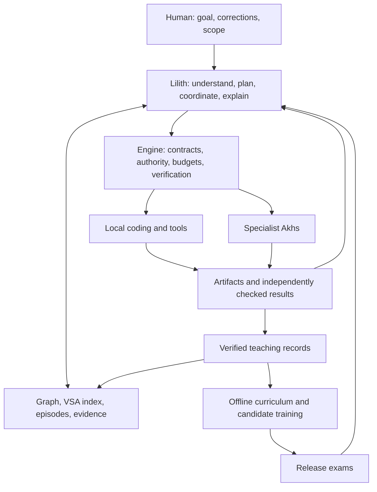

# Project Lilith — Gemma-based human interface and Akh coordinator

Date: 2026-09-21. Status: implementation proposal with an open decision map. No model training or deployment performed. User decisions: use the Gemma 4 track; carry forward ADAM/Kaine capabilities; prioritize human interaction and coordination; support preliminary coding and VSA-mediated learning from existing agents; **execute end-to-end within assigned scope**. Addition: **match or beat Qwen 3.8 27B on the agreed benchmarks**, diagnose failures to improve understanding and coding quality, and make **illumos the primary operating system**.

## Product outcome

Lilith is the person-facing Akh who understands what the human wants, maintains continuity, coordinates specialists, verifies their work, and brings the result back in understandable language. She can investigate a repository, write a bounded initial patch, run checks, and seek specialist help when evidence or competence is insufficient. Coding supports her coordinating role; specialist implementation remains a normal path to completion.

Example: a human asks for a small feature. Lilith establishes its acceptance criteria, recalls relevant prior work, inspects the repository, and either prepares the patch or assigns it to an appropriate Akh. She tracks dependencies, resolves conflicting reports against evidence, verifies the resulting artifact, completes publication when covered by the assignment, and reports the outcome. Afterward she retains a verified lesson. A later related task tests whether that lesson improves her own performance.

Lilith names the inherited Gemma track described in the [hardware plan](2026-09-19-capable-8-12b-akh-hardware-plan.md). ADAM and Kaine keep their sovereign meanings from [ADR 111](../decisions/111-kaine-architecture-ladder.md). This resolves that plan’s ambiguity about calling the inherited workhorse Kaine. Its historical proposal remains intact; this document records the new direction.

illumos is both Lilith’s primary operating environment and the main domain for her systems understanding and coding work. This supersedes the provisional Mac deployment target below; training hardware and optional inference accelerators are separate placement decisions.

## Starting point and evidence limits

- Start with the repository-selected Gemma 4 12B candidate. Google documents a 12B model with text, image, and audio inputs; actual Akh backend support must be demonstrated independently. Pin the precise checkpoint, tokenizer, template, precision, and backend before any comparison. [Google model guide](https://ai.google.dev/gemma/docs/get_started), [12B developer guide](https://developers.googleblog.com/gemma-4-12b-the-developer-guide/).
- Reuse the native Akh runtime, graph, tools, and memory. Local code inspection found peer selection/delegation in `src/agent/delegation/peer.rs`, task contracts in `src/agent/delegation/types.rs`, episodic consolidation/recall in `src/agent/memory.rs`, structural code encoding in `src/vsa/code_encode.rs`, and a neural projection bridge in `src/vsa/neural_bridge.rs`. Their existence does not establish Lilith integration or release readiness.
- `src/bin/akh_episode_generator.rs` already derives training examples through symbolic, temporal, and causal engine execution. Use this as a starting seam; the complete board/Anima/executor dojo environment in P7 is planned work, not assumed available.
- ADAM’s model-specific loader, tokenizer, checkpoint formats, foundation-token requirements, and training architecture cannot simply be applied to Gemma. Preserve their behavioral and evidence requirements through an explicit inherited-model certification path.
- This is a repository-based inventory, not a live Anima status audit. Before scheduling, reconcile current tracker work through Anima MCP and record reusable completed items. Existing P6/P7 sequencing and compute governance remain dependencies where their code or training lanes are reused.

## Capability transfer ledger

“All capabilities” means every family below remains traceable to a source, implementation task, and exam. It does not assert that all proposed ADAM/Kaine research already works. L0 expands this ledger into a complete source-by-source inventory; any omission must receive an explicit disposition.

| Capability family / source | Lilith mechanism | Evidence required / current qualification |
|---|---|---|
| Goal understanding, grounded planning, reasoning and repair — R1, ADR 092/093 | Gemma proposals plus engine-checked High Grug/graph reasoning; explicit neural/engine handoffs | New relations and task compositions; preserve exact IDs, paths, and negation; report host assistance |
| Tool discovery, schema fidelity, unfamiliar commands and Unix composition — ADR 102, R1 | Live captured contracts, documentation acquisition, versioned skills, execute/observe/repair loop | Changed schemas and command semantics; unavailable-tool cases; fresh verification |
| Knowledge acquisition, source revision, study notes and provenance — ADR 102 | Existing Seshat/graph/note tools, revision-aware writes and supported belief invalidation | All seven stateful knowledge families plus current-tool coverage; stale/conflicting sources |
| Persistent memory and learning after restart — R1 | Episodic records, graph facts, VSA retrieval, exact source artifacts | Cold restart/reuse with frozen weights; corrections change subsequent actions |
| Human interaction, emotional repair, Dojo, voice selection — ADR 099/110 | Train appropriate communicative moves; act on corrections; adapt detail and timing | Blinded interaction rubric plus observable next-action repair; retain eight crew dispositions as skills, not eight new Akhs |
| Languages and registers — R1, ADR 092, Gemma track | EN/DE/FR retention, Portuguese basics, High Grug internally; retain optional Apertus routing for Swiss-language needs | Per-language comprehension/action scores and identifier preservation; distinguish routed from local performance |
| Coordination and operational work — ADR 110, homelab exam | Peer capability discovery, scoped delegation, board/tracker lifecycle, dependency and budget tracking | Multiple specialists, failures, interruptions, duplicate events, and conflicting reports; verified terminal state |
| Preliminary coding and teaching — user requirement, R1 transmission | Repository inspection, small patches, relevant checks, specialist review/teaching, reusable lessons | Held-out repository tasks; test and scope correctness; measured benefit from other agents’ lessons |
| Symbolic/temporal/causal learning — P6 | Engine-verified trajectories and corrected examples | Separate E1/E2/E3 ablations; no fabricated effect labels |
| Character and guided reward — ADR 110 / P7.10–13 | Five-component effect/validity/provenance/disposition/budget record; versioned nonnegative weighted SFT and corrected siblings | Actual environment receipts; independent social rubric; no aggregate hiding a missing family |
| Perception→graph→action — R1, ADR 103, Gemma audio work | Existing model-specific image/audio paths where verified; teach grounding and downstream use | Separate actual image/audio exams from transcript/OCR controls; input audio does not establish speech output |
| Hypothesis formation, compression-progress curiosity — foresight archive | Bounded evidence-seeking and hypothesis revision in the coordinator | Research extension; compare productive information gain with novelty-only/fixed exploration |
| Replay-improved exploration and repair — Dream-RSI archive | Offline replay experiments around a frozen model, then fresh online validation | Research extension; whole-task splits, hidden future outcomes, full cost accounting |
| Typed composition / joint learning — TypeSafe/Jev and Jevlike archives | Investigate applicable typed planning and shared-representation ideas | Research extension; prove compatibility and task benefit before adopting |
| Kaine backbone/memory-layer experiments — ADR 111 / P7.5–9 | Preserve the behavioral aims through the engine; investigate a Gemma-compatible bridge only if needed | Sovereign architecture experiments are not weight-compatible imports; any internal memory layer is a separately gated research change |

## Runtime and authority

Assigned scope includes the goal, acceptance criteria, repositories/resources, permitted effects, budget, deadline, and completion destination. Lilith proceeds through the whole workflow without recurring permission requests for already-authorized actions. She asks when information is necessary or the task would exceed its scope. The runtime enforces this boundary; model prose cannot grant new authority.

Delegations carry the parent scope and a narrower task contract, stable correlation identity, required capabilities, acceptance evidence, budget, and cancellation semantics. A completion message triggers verification of artifacts and final state. It is not itself proof of completion. Define durable states for assignment, acknowledgement, running, blocked, verification, completion, failure, and cancellation; recover them after restart without duplicate side effects.

Lilith owns the human conversation and the aggregate outcome. Horus’s coordination/security role and the other Ennead specialties remain available through explicit task ownership. An Akh deployment/persona and a model lineage are distinct concepts: choosing Lilith’s backing model does not require adding a seventh variant to the six-persona LoRA enum.

## VSA-mediated apprenticeship

1. **Observe:** capture an existing agent’s task, initial conditions, relevant source revision, attempts, patch, tool results, tests, and verified outcome. Include failed attempts and the reason a correction worked.
2. **Admit a lesson:** require an attributable teacher/episode, artifact hashes, reproducible verification, applicable conditions, and counterexamples. Unsupported claims remain unverified observations and cannot become successful teaching targets.
3. **Represent:** retain exact source/diff/test artifacts and provenance in durable storage; use VSA encodings for structural and task similarity. A hypervector indexes a lesson; it does not replace the lesson’s exact contents.
4. **Transfer:** exchange a versioned lesson envelope. Validate access scope, encoder version, dimensions, seed/codebook identity, and symbol mapping. Prefer re-encoding portable symbolic/code features locally when peers use incompatible vector spaces. Model-specific hidden states require an explicitly aligned bridge.
5. **Apply:** retrieve candidate lessons, check repository/tool versions and preconditions, inspect the original evidence, then generate and test a new patch. Similarity alone cannot authorize or validate a change.
6. **Correct:** invalidate or supersede stale lessons, preserve their history, and prevent circular peer retelling from counting as independent evidence. A changed dependency or failed replay lowers applicability immediately.
7. **Consolidate:** periodically train on admitted trajectories using a versioned offline curriculum. Training produces a candidate; only full regression and capability exams permit activation.

First prove memory-based improvement with frozen Gemma weights. Compare **no lessons**, **ordinary text retrieval**, and **VSA-assisted retrieval** on the same held-out task families and equal context/tool budgets. Add **VSA plus adapter training** only afterward. Split by repository/task family and semantic problem, deduplicate teacher traces, and keep evaluation solutions out of both retrieval and training. Measure executable correctness, unintended changes, attempts, specialist interventions, latency, and cost. If VSA does not beat text retrieval, retain the useful teaching workflow and investigate the representation before claiming a VSA gain.

## Qwen comparison and illumos quality program

**Release requirement: Lilith must match or beat the pinned Qwen 3.8 27B reference on every agreed primary benchmark and critical illumos task family.** An aggregate gain cannot compensate for a regression in coding, understanding, memory, coordination, or illumos correctness. This is a target to demonstrate, not a current performance claim. Passing the absolute floors below is necessary but insufficient when Qwen scores higher.

L0 freezes the exact reference artifact/provider revision, inference configuration, benchmark versions, task hashes, primary metrics, budgets, and statistical decision rule before tuning. A mutable model alias is insufficient for reproducible comparisons. “Equal” requires an adequately powered, predeclared equivalence test with a practically negligible tolerance; failure to find a significant difference is not evidence of equality. Define tolerances by metric and operational consequence; do not automatically inherit the older five-percentage-point noninferiority allowance. Superiority requires a positive paired difference with uncertainty reported. Insufficient evidence leaves the gate unresolved.

Use two separately reported comparison tracks:

- **Controlled model comparison:** Gemma/Lilith and Qwen get the same Akh harness, offered tools, starting memory, retrieval access, task snapshots, context policy, and comparable inference/tool budgets. Disable specialist delegation here. This measures Lilith’s own understanding and coding; label engine repairs and retrieved lessons.
- **Deployed system comparison:** Lilith and a Qwen-backed coordinator get equivalent specialist access, initial knowledge, permissions, and total task budgets. Count every worker call, retry, tool action, token and wall-clock cost. This measures end-to-end orchestration without attributing a stronger worker’s solution to Lilith’s own coding competence.

Report both quality and cost/latency curves. Faster or cheaper execution does not compensate for failing the quality target. Keep Qwen as an independently evaluated reference even when it also supplies teaching examples; hold its evaluation traces out of Lilith’s training and memory.

### Benchmark coverage

Reuse the benchmark directions in [ADR 086](../decisions/086-feature-test-vm-harness-benchmarks.md) and the [Phase 50 plan](2026-07-05-phase50-feature-test-benchmarks.md), after auditing what actually runs. Named public suites are an initial selection to verify and freeze in L0, not an assertion that their adapters or current versions are ready.

| Track | Initial evidence set | What it must establish |
|---|---|---|
| General repository coding | Existing FrontierCode/public SWE-bench task harness | Locate a defect, understand surrounding code, produce a maintainable patch, and pass independent checks |
| Persistent understanding and memory | LoCoMo, LongMemEval, plus Akh revision/restart episodes | Use the right evidence, correct stale beliefs, and retain useful lessons without leaking held-out answers |
| Terminal work | Terminal-Bench subset as a separately labeled Linux comparison; native illumos tasks for deployment | Discover real command semantics, diagnose failures, execute and verify; Linux success does not certify illumos |
| Human interface and coordination | Akh interaction-repair and fleet-orchestration exams | Understand corrections, assign appropriate work, reconcile evidence, recover and complete |
| illumos understanding and coding | New sealed illumos repository and systems tasks | Source-grounded explanation, native build/test success, invariant preservation, and transfer to unfamiliar changes |

The illumos pack begins with the existing proposed SMF, manpage discovery, C/libkstat/libscf, Rust, and RBAC families. Expand the coverage specification to IPS packaging, zones, ZFS, DTrace-based diagnosis, concurrency/resource lifetime, error paths, and ABI/API compatibility where relevant to assigned work. Include Linux/Solaris assumption traps, changed versions, incomplete documentation, misleading symptoms, and unfamiliar subsystem combinations. Stage harder kernel/driver tasks as diagnostic and later capability targets; preliminary coding release claims must name their supported task class explicitly.

Each coding task pins a source revision, native toolchain, distribution/image, setup, intended behavior, and hidden verifier. Use clean isolated illumos environments, compile and run the relevant native checks, inspect the resulting diff, and assess maintainability through a blinded reviewer rubric. Test operational tasks against actual final state. An explanation must cite the relevant source/manpage, predict observable behavior, and survive a changed condition or counterexample; plausible prose and a passing visible test alone are insufficient.

### Failure diagnosis drives tuning

Every failed development/validation case receives an evidence-linked record: task and environment hashes, expected versus observed behavior, first consequential divergence, relevant source and tool receipts, root-cause hypothesis, discriminating replay/probe, proposed remedy, and outcome on a fresh related case. Also inspect lucky passes, both-model failures, and disagreements between public scores and native illumos outcomes.

Classify failures as task comprehension, OS/domain knowledge, source navigation/retrieval, reasoning/planning, code semantics, concurrency/lifetime/ABI, tool/environment execution, stale memory, verification, coordination, or interaction. Mark uncertain diagnoses explicitly. A broken fixture, absent compiler, or backend fault is a harness failure to repair and rerun, not automatically a model deficit; publish excluded cases and reasons.

Choose the remedy from that evidence: native runtime/tooling fixes for execution faults; corrected documents and VSA lessons for missing or stale evidence; varied concept and code exercises for understanding gaps; verified SFT/corrected siblings for recurrent reasoning or coding errors. Each intervention states a causal hypothesis and includes retention tests. Vary subsystems, surface syntax and failure mechanisms so a lesson must transfer beyond its originating task.

Keep sealed release cases, hidden verifiers, expected patches and solution-bearing teacher traces out of training and retrieval. Split by task lineage, subsystem/repository, and semantic problem; public benchmark contamination remains a reported limitation. Once a sealed failure is used to tune, move it to development and replace it with independently authored sealed work. Promote only when gains reproduce on fresh illumos tasks and broader retention gates still pass. Do not tune the scorer or repeatedly select adapters against the final exam.

### Native operating environment

L0 audits illumos build, packaging, service management, executor permissions, storage, networking, model-serving dependencies, and available hardware, using [ADR 079](../decisions/079-release-packaging-workflow.md), [ADR 082](../decisions/082-privilege-separated-executor-backend.md), and ADR 086 as starting points. Record an explicit support matrix and measured blockers. Native model inference on illumos is a requirement to investigate, not an assumed capability; distinguish a native Lilith runtime with a remote inference service from a fully local deployment. Any remote inference dependency must be explicit in deployment and outage tests.

Other operating systems may supply training or acceleration, but the shipped Lilith workflow must be exercised on illumos: install/upgrade, start/restart, persistent memory, tool execution, delegation, cancellation, recovery, and rollback. An Apple/Linux-only pass cannot close this deployment gate.

## Local-first execution update — 2026-09-21

The user deferred validation until host setup is ready and selected **illumos VMs on hephaistos** as the native validation environment. Qwen comparison and native acceptance remain release gates; their unavailability must not block local engineering.

Proceed now with local Gemma inference diagnosis, an isolated Lilith runtime configuration, versioned evaluation/lesson contracts, harness correctness, and offline curriculum preparation. Keep runnable local diagnostics separate from capability scores. Prepare the VM topology and reset/verification interfaces as files; do not start native validation or mutate VM host setup before it is ready. Pin distribution/image, resource allocations, networking, and snapshot policy during VM preparation.

The independent project stack uses a dedicated session daemon, local `akhrtd`, and sandbox daemon; workspace execution can reside in an illumos VM. The existing command provisioner is the VM backend seam. Ptah is authorized as the local Qwen reviewer/reference candidate on this same stack, with separate identity and history. One runtime serializes native inference and unloads the previous model before loading another; simultaneous model residency is unnecessary. Ptah reviews explicit artifact handoffs, while deterministic checks own correctness. Label its exact derivative and keep comparison performance distinct from reviewer judgments. See [local stack preparation](../../../examples/lilith/README.md).

The L0 contract can remain partially open while independent engineering proceeds. Mark reference/VM-dependent fields pending rather than inventing evidence. Resume paired model evaluation and native illumos trials when host setup is ready. This changes scheduling, not the quality requirements.

## Native validation authorization — 2026-09-22

The user has now authorized steps 1–5 and local VM preparation from Solstice CI,
with a Refraction Forger rebuild if necessary. This supersedes the earlier native
validation deferral. A project-owned OpenIndiana 2026.04 guest now boots and runs
Python/C/Rust checks through a bounded SSH executor. The source images remain
unchanged. Full native Akh deployment and lifecycle acceptance are still open.

The next same-pack deployed comparison completed: Gemma 4/8, pinned Ptah derivative
6/8. Baseline/SFT/KLPO each scored 4/8 in the separate BF16 experiment. These are
public development measurements, not release certification; no adapter promotion
or Qwen parity claim is justified. See [the five-step run](2026-09-22-lilith-next-five.md)
for evidence and remaining checks. The new model-backed delegation/patch/native
test/review/report episode completed with separate backend processes; its final
report took 452 seconds, leaving Vulkan reporting latency as a runtime gate.

## Delivery sequence

These are proposed implementation slices, not dispatched tracker items. Dependency order is more meaningful than calendar estimates until the baseline is measured.

| Slice | Depends on | Deliverable and exit condition |
|---|---|---|
| **L0 — inventory and contract** | — | Map every relevant ADAM/Kaine plan, ADR, research extension and current Anima item to reuse/adapt/research status; freeze Lilith’s task/scope/lesson contracts, family coverage, and development/validation packs. Produce a gap ledger with owners and evidence links; freeze the Qwen comparison, statistical parity rule, and illumos platform/benchmark contracts. |
| **L1 — Gemma runtime baseline** | L0 | Pinned Gemma artifact runs complete episodes through actual Akh tools and persistent memory. Record raw proposals versus engine repairs, cold restart behavior, peak memory, first-action and task latency on intended hardware. Produce paired Lilith/Qwen per-family baselines, native illumos runtime evidence, and a first failure-diagnosis ledger. |
| **L2 — human interface and coordination** | L1 | Human request → delegation to at least two specialists → independent verification → truthful completion. Demonstrate interruption, user correction, peer failure, cancellation/revocation, duplicate delivery, and restart recovery within scope. |
| **L3 — preliminary coding** | L2 | Inspect, patch, run relevant checks, diagnose failures, request specialist help, and finish the assignment. Use isolated workspaces and bounded tasks; freeze starter task families such as small bug fixes, tests, configuration, and small feature changes. Deliver an executable held-out coding exam centered on native illumos work, including source comprehension and independent patch review. |
| **L4 — peer teaching and VSA** | L3 | Versioned lesson admission, transport, local encoding, retrieval, revision, and replay. Run the frozen-weight three-arm comparison; show cold reuse and rejection of misleading/stale lessons. Report uncertainty rather than promising improvement. |
| **L5 — Gemma adaptation** | L4 | Train only measured weaknesses from verified coordination/human/coding trajectories with retention replay. Validate the exact training/export/backend path in a bounded smoke before a full run. Candidate records all parent/adapter/contract/data hashes; every tuning intervention links to diagnosed failures and fresh transfer results, and passes per-family exams. |
| **L6 — integrated release** | L5, or L4 if baseline already passes | Certify the exact deployed backend/precision/adapter configuration, exercise rollback and persistent-state compatibility, then run an authorized canary and record its outcomes. Require Qwen parity/superiority evidence on all frozen primary comparisons and the native illumos deployment gate. No fine-tune is mandatory if the frozen model already meets the contract. |
| **L7 — advanced transfer** | L6 | Separate experiments for foresight, curiosity, replay allocation, typed joint learning, and optional neural-memory bridges. Each names a falsifiable hypothesis, control, compute cap, promotion gate, and stop condition. Keep failed experiments visible in the capability ledger. |

Train coordination and human-interaction examples as primary curriculum families; coding and all inherited retention families remain independently gated. Freeze sampling proportions after L1 establishes weaknesses. Start with one adapter recipe; same-base adapter composition/breeding follows only if specialization has measured benefits. Transfer behavior from other lineages through verified examples, not direct weight merging. The existing [Gemma breeding research](../research/2026-09-20-model-breeding-gemma4-trunk.md) informs later experiments; recheck tooling support at L5.

## Acceptance and release evidence

Reuse the full R1 behavioral requirements and preserve existing ADAM regression suites as controls. Do not silently weaken their thresholds or treat ADAM’s sovereign foundation-token requirement as applicable proof for inherited Gemma. L0 must explicitly map every existing gate to retain/adapt/not-applicable with rationale, including an inherited-model manifest and certification verifier.

Initial Lilith-specific proposed floors, to freeze before evaluating candidates:

- At least 100 independent sealed worlds per core family; coordination succeeds end-to-end in at least 90%, preliminary coding in at least 85% of the declared starter-task class. Existing stricter applicable gates take precedence.
- Zero observed out-of-scope effects or fabricated completion claims in release trials. Report attempted violations blocked by the host separately; zero observed failures is not a universal guarantee.
- At least 90% of correction/interaction-repair episodes change the next action appropriately and pass a blinded rubric; report EN/DE/FR and Portuguese basics separately.
- At least 200 independent learn/restart/recall episodes for persistent learning, following the R1 exam design. Verify that invalidated lessons stop influencing actions.
- A VSA improvement claim requires a predeclared practical margin and a paired confidence interval above zero on executable task success against text retrieval. Fix that margin and power/sample plan in the apprenticeship decision before collecting comparison results. An inconclusive result remains inconclusive.
- Performance is measured on the primary illumos deployment profile: total runtime/model/graph memory, concurrent work, p95 first-action latency, sustained memory pressure, and any remote inference/network costs. Freeze actual hardware and resource ceilings in L0; the earlier 16 GB Mac profile is an optional comparison only.
- Match or beat Qwen 3.8 27B under the frozen comparison rules above; report each primary benchmark and critical illumos family separately. Missing, underpowered, or failing evidence blocks a parity claim and full release.

Evaluate full episodes with frozen graders and independent worlds. Preserve training, development, validation, and sealed-release boundaries. Publish per-family results, assistance profiles, failed cases, confidence intervals, and resource costs. Neither keyword F1 nor decreasing training loss certifies Lilith.

## Sources and next decisions

- [R1 capabilities](2026-09-11-akh-350m-graph-grounded-release-plan.md), [homelab release exam](2026-09-11-akh-homelab-release-exam.md).
- [P6 engine learning](2026-09-13-phase51-p6-local-training-neurosymbolic.md), [P7 architecture/environment/reward plan](2026-09-14-phase51-p7-kaine-architecture-ladder-and-training-engine.md).
- [ADR 102: tool-native learning and certification](../decisions/102-tool-native-learning-model.md), [ADR 110: character and guided reward](../decisions/110-kaine-character-guided-reward-live-environment.md), [ADR 111: sovereign lineage](../decisions/111-kaine-architecture-ladder.md).
- [Foresight/curiosity archive](../research/2026-09-16-kaine-foresight-curiosity/README.md), [Dream-RSI archive](../research/2026-09-16-dream-rsi-adam-kaine/README.md), [TypeSafe/Jev archive](../research/2026-09-16-typesafe-jev-adam-kaine/README.md), [Jevlike archive](../research/2026-09-16-jevlike-adam-kaine/README.md).
- [Decision map](2026-09-21-project-lilith-decisions.md) tracks the remaining investigation frontier. This plan is complete as a proposed sequence; hardware fit, full capability coverage, integration availability, and learning gains remain to be established.

## KLPO experiment authorized — 2026-09-21

The user approved recording the [KLPO assessment](../research/2026-09-21-lilith-klpo.md) and executing the next local slices: probability-faithful trajectory capture, independent loss/verification tests, and a bounded synchronous HF/ROCm LoRA comparison against unchanged and supervised controls. The existing Vulkan deployment remains unchanged. Record complete sampler provenance and independent terminal rewards; historic text-only episodes are not retroactive KLPO data. Keep task-family holdouts, real failures, resource limits and cold reload explicit. This experiment cannot close the broader coding-quality, Qwen-parity or native illumos gates.

Execution evidence: the [first bounded RL run](../../../training/lilith/rl-20260921/README.md) completed 24 responses and actual SFT/KLPO updates. Strict scores did not improve. Independent diagnostics identify Markdown wrappers as the reward contrast; meaningful coding adaptation requires fresh semantic-failure tasks and a separately versioned artifact contract.
