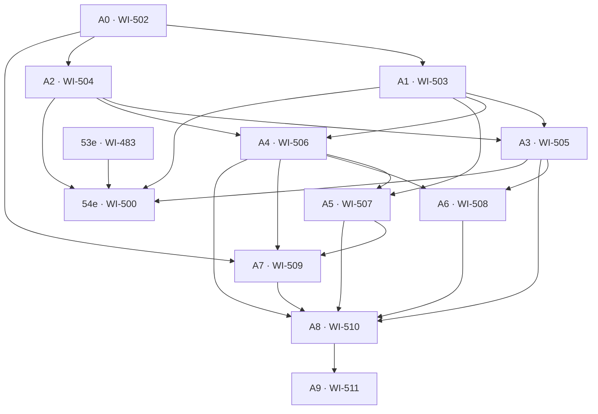

# Implementation plan: typed execution and akhpack v1

Date: 2026-09-22; published 2026-09-27.
Status: implementation plan registered; all ten items draft, no dispatch or native acceptance claimed.
Architecture: [ADR 115](../decisions/115-typed-execution-and-akhpack-v1.md).
Anima: [Akh-Medu Plan](https://anima.wegmueller.it/plans/01a0e25c-390c-7c61-ab5e-0fd7b910ad1f).
Workflow: Feature Development (`10000000-0000-0000-0000-000000000001`).
Shared documents: [ADR](https://anima.wegmueller.it/documents/01a0e25c-3924-7271-8a23-be604ed5702a) · [Plan](https://anima.wegmueller.it/documents/01a0e25c-393b-76e1-a65e-2174f7abb29c).

## Scope and completion

Deliver a shell-free TypeScript execution environment in `akhexecd`, with no
admitted `any`, intent-specific operations, sandbox-local Shen editing, on-demand
WASM installation, opaque credentials, bounded event/inference workflows and
read-only packed VFS mounts. Prove the integrated path natively on `oibuild`.

A0–A9 are stable slice names, mapped to native Anima Work Items below. Each item
belongs to this Plan and the Akh-Medu project, with the Feature Development
workflow. Related WI-420/provider ownership, WI-472/output budgets and existing
Shen work remain owned by their current workers.

ADR 113 keeps the full Akh and admission in `akhomed`; all caller effects route
through `akhsbxd`/`akhexecd`. ADR 114 keeps structural decisions live and learned
classifiers in shadow. The small discovery surface must never strip the Akh's
full tool registry or cognition. Deploy only from `origin/main`, with short SHA.

## Ordered slices and acceptance

| Slice | Depends on | Responsibility / proposed ownership | Reviewable result and acceptance |
| --- | --- | --- | --- |
| A0: contract and native feasibility | none | `akh-session-types`; isolated qualification harness | Versioned operation/target/receipt contracts; native TS-checker, JS, WASM, parser and ZIP read probes on oibuild; native descendant restrictions feasibility. Record pinned versions, exact failures and necessary ports. |
| A1: package format and VFS | A0 | proposed `crates/akhpack`, `crates/akh-vfs`; adapters in `workspace.rs` and `src/fs` | Normative v1 manifest/inventory/path/limit spec; reproducible pack writer, hostile-input reader and immutable mounts. Open the same packed fixture on macOS and illumos without extraction. |
| A2: typed cell admission and interpreter | A0 | proposed `crates/akh-repl`; executor worker integration | Curated no-any declarations; semantic type gate; checked cells, async host calls and cancellation. No dynamic-code or ambient OS bypass. Bound memory, CPU and output. |
| A3: package activation and component bridge | A1, A2 | `akhpack`, REPL loader, WASM runtime/WIT | Resolve/pin/verify/activate transaction, generated TS contracts and runtime codecs, exact WIT compatibility and host imports. Install updates types for the next cell; active cells retain their lock. |
| A4: sandbox state and switching | A1, A2 | session/executor/sandbox services and shared types | Explicit environment selection, binding-generation fencing, schema-versioned durable state, receipt recovery and output cursors. Switch A→B→A without data or authority leakage; restart without effect replay. |
| A5: Shen source editing | A1, A4 | `crates/shend` plus sandbox worker and VFS edit adapter | Rust/TS syntax snapshots, node queries, typed structural edits, preview/commit/reparse and diagnostics. Revision conflict and incomplete rename resolution fail explicitly. Crash recovery preserves a declared workspace revision. |
| A6: credentials, inference and reactions | A3, A4 | host capability broker, inference client, akhomed admission and thin event ingress | Opaque credential sinks, protected values, schema-checked shadow classifier output, structural live routing and pinned handlers. Prove no plaintext guest exposure, target restrictions, deduplication and bounded reactions. |
| A7: typed development/host operations | A0, A4, A5 | repository/bootstrap/publication/snapshot services; diagnostics/build adapters | Replace shell use cases with domain operations. Prove shell-free process descendants for admitted native build jobs; report unsupported toolchains explicitly. |
| A8: remove shell surfaces and migrate providers | A3–A7 | executor/broker, `src/agent` backends, provider adapters and fixtures | Remove command strings, generic argv, remote-shell paths and provider fallbacks. Conformance rejects clients that retain bypasses. Replace test shell fixtures with native helper binaries. |
| A9: integrated native release gate | A8 | integration fixtures and native evidence | Complete the scenario and negative matrix below on oibuild at the exact candidate revision. Review/CI and deployment remain separate subsequent gates. |

A0 does not need the finished SDK: minimal probes with explicit stubs establish
dependency and OS feasibility. A1 and A2 can proceed independently after A0.
Develop in isolated commits/worktrees preserving unrelated research files. Do not
turn on a partially migrated configuration for production sessions. The final
release has no compatibility flag restoring shell execution.

## First integrated scenario

1. Attach a session to sandbox A with a fixed grant set. Discover one parser
   package and fetch only its requested export documentation.
2. Install an exact-digest `.akhpack`; verify archive/inventory/contracts and mount
   it read-only. Confirm no extracted package tree exists.
3. Compile a cell against the new lock using the no-any SDK. Feed fixture bytes
   to its WASM parser, filter typed records, store a durable result and print a
   bounded plain-text view.
4. Use Shen to inspect a Rust function and replace one syntax node. Preview,
   revision-check, commit, reparse and run the admitted diagnostics/test operation.
   Repeat a TypeScript edit of a parser/handler with type diagnostics.
5. Use a synthetic credential handle against a controlled authenticated fixture.
   Verify host authentication succeeds and the token is absent from guest state,
   output, errors, transcripts, persisted cells and telemetry. Test an echoing
   server and deny/contain that disclosure route.
6. Admit an event to a registered handler. Invoke a deterministic inference
   fixture first, then one real configured small model for integration evidence.
   Validate the result schema and trigger one already-authorized state change.
   Use structural decisions for the live action and retain learned-model output
   as shadow evidence. Record latency; this smoke test grants no learned dispatch
   authority and makes no classifier-quality claim.
7. Switch to sandbox B and demonstrate isolation and differently scoped host
   controls. Return to A and retrieve the retained data without re-ingestion.
8. Restart the interpreter/executor. Restore explicit durable data and handler
   definitions, invalidate live handles and reconcile an injected unknown effect.
   Do not rerun the authenticated request or committed edit.
9. Attempt legacy shell/argv calls through every provider and transport surface;
   they must be unavailable or rejected without process creation. Observe native
   process descendants for the entire scenario.

Pass means all steps complete on native illumos. A Linux pass, a WASM hello-world,
an installed archive, or a successful parse alone is not this gate.

## Focused negative and recovery matrix

| Boundary | Cases | Required observation |
| --- | --- | --- |
| Type admission | explicit any, implicit callbacks, imported/deep/generic any, unchecked JSON, assertion laundering, directive suppression, unchecked JS | Reject before execution; legitimate narrowed unknown and typed generic programs pass. |
| Runtime authority | forged structural handle, expired generation, wrong sandbox, stale package lock | Reject with a typed error and no effect. |
| Shell removal | shell tool, command string, generic argv, provider built-in, WASI process import, helper/hook, shell-spawning build script | No shell process or generic launch escape. Unsupported jobs are visible failures. |
| Resource control | endless JS/WASM loop, native regex blowup, unbounded async stream, oversized output, parser recursion | Deadline/cancellation and quotas hold; sibling environments remain responsive. |
| Archive/VFS | traversal, symlink/device, duplicate/colliding path, overlapping ranges, forged sizes/digests, ZIP bomb, unsupported method, dependency cycle | Reject before activation; bounded resource use; no extraction or root escape. |
| Activation | interrupted download, concurrent installs, mismatched WIT, unauthorized import, forged TS declaration, failed migration | Old environment stays valid; no partial lock or privilege expansion. |
| Editing | stale node/hash, competing writer, syntax error, incomplete resolution, crash during multi-file commit | No guessed rename or silent overwrite; deterministic recovery and explicit state. |
| Credentials | printing, interpolation, JSON, exception, artifact storage, guest memory, redirect, cross-host reuse, echoed response | Handle remains opaque; sinks/data-release rules hold; diagnostics contain no credential bytes. |
| Reactions | duplicate event, malformed model result, retry storm, recursive trigger, exhausted budget, ambiguous external completion | One authorized effect or explicit pending/failed state; bounded retries, no blind replay. |
| Persistence | restart after effect before response, invalidated handle, schema upgrade/downgrade, lock rollback | Retain receipts and unknown outcomes; restore only compatible durable values. |

## oibuild qualification protocol

`oibuild` is the user-required native test host. Prior workspace notes describe it
as a shared non-global-zone build host, with scratch under `/ws/toasty` and a
two-job default. Those details are not freshly verified in this design turn:
confirm the current SSH route, identity, zone, paths and capacity before running.

For implementation:

1. Read the current host/workspace instructions. Coordinate remote activity on
   the existing Agent Board under the implementing session's own identity, using
   its coordination skill. Announce scope and finish with evidence/blockers.
2. Inventory OS/architecture, compiler/linker, Rust target, available memory and
   dependency versions read-only. Use a unique scratch checkout; no shared-host
   package/configuration changes. Start with two build jobs.
3. Transfer a committed source revision or explicit checksummed archive. Do not
   copy a local worktree's `.git` pointer or delete an existing remote checkout.
4. Build minimal A0 probes, then each owning crate and the executor-only service
   dependency closure. Pin engines/checker/grammar/archive libraries in locks.
5. Execute native tests, not merely compilation. Exercise descriptor-relative IO,
   compressed reads, UTF-8 boundaries, interruption, event-loop integration and
   WASM host calls on the target OS.
6. Run A9 with synthetic secrets and native process observation. Keep operator
   SSH/build transport separate from system-under-test process trees. If native
   enforcement or observation cannot establish the shell-free property, record
   the exact missing mechanism and leave the release gate incomplete. Do not
   solve it by modifying this shared host or relaxing the contract.
7. Save source SHA, lock/archive digests, host/toolchain facts, test names,
   commands or harness invocation, exit codes, logs, effect receipts, process
   observations and proof limits under a dated evidence directory. Remove only
   scratch artifacts owned by that run and report completion on the same thread.

Future test script names and crate names above are proposals, not runnable
commands in the current checkout. The implementation must supply the harness.

## Migration coverage and stop conditions

Inventory production call sites before A8, including `src/agent/tools/shell_exec.rs`,
`src/backend`, `crates/akh-session-services/src/executor.rs`, `broker.rs`,
`repository_bootstrap.rs`, publication/snapshot paths, helper/provider launchers,
`scripts/agent-backends` and registered upstream MCP tools. Search beyond these
starting paths. Classify shell-dependent test fixtures separately.

The broker must reject upstream tools that reintroduce generic shell execution.
Disabling an advertised tool name without disabling its endpoint is not removal.
The planned system cannot claim control of a provider's native local tools unless
its integration proves those tools are disabled or routed through the executor.

Stop release progression on: no native engine/component support, inability to
enforce no-shell descendants, exposed any in the admitted type environment,
credential disclosure, incomplete edit recovery, provider bypass or unresolved
effects. Produce a concrete engineering blocker and retain the fixed requirements.

## Review decisions

The next implementation review selects pinned engine/compiler versions from A0,
sets the v1 package limits and trust policy, and approves the concrete type/codec
contracts. It must also resolve which native build workflows can satisfy the
shell-free rule. General toolchain compatibility is not assumed from AST editing.

Published to the hierarchy below on 2026-09-27. Items remain draft for operator
promotion; no implementation, native runtime acceptance or deployment is claimed.

## Native Anima hierarchy and DAG

| Slice | Work Item | Hard prerequisites |
| --- | --- | --- |
| A0 | [WI-502](https://anima.wegmueller.it/work-items/01a0e25d-8308-7453-a7b8-4829025e925d) | none |
| A1 | [WI-503](https://anima.wegmueller.it/work-items/01a0e25d-835a-7530-8d64-882d1ec22277) | A0 / WI-502 |
| A2 | [WI-504](https://anima.wegmueller.it/work-items/01a0e25d-83b3-7681-984c-6a5c6381a591) | A0 / WI-502 |
| A3 | [WI-505](https://anima.wegmueller.it/work-items/01a0e25d-83fc-7513-8434-a1b4452d9b19) | A1 / WI-503, A2 / WI-504 |
| A4 | [WI-506](https://anima.wegmueller.it/work-items/01a0e25d-844d-78f1-88a6-9d914a4e8037) | A1 / WI-503, A2 / WI-504 |
| A5 | [WI-507](https://anima.wegmueller.it/work-items/01a0e25d-8495-7a80-918f-6bd15ae97066) | A1 / WI-503, A4 / WI-506 |
| A6 | [WI-508](https://anima.wegmueller.it/work-items/01a0e25d-84df-7083-b27d-a55f14922728) | A3 / WI-505, A4 / WI-506 |
| A7 | [WI-509](https://anima.wegmueller.it/work-items/01a0e25d-8519-76d2-86ee-21c205e84c16) | A0 / WI-502, A4 / WI-506, A5 / WI-507 |
| A8 | [WI-510](https://anima.wegmueller.it/work-items/01a0e25d-855c-79e1-ad0b-40bc8c6e7b54) | A3 / WI-505, A4 / WI-506, A5 / WI-507, A6 / WI-508, A7 / WI-509 |
| A9 | [WI-511](https://anima.wegmueller.it/work-items/01a0e25d-85d7-7123-a277-6c4e04731f7a) | A8 / WI-510 |

There are 19 internal hard edges. The existing [54e / WI-500](https://anima.wegmueller.it/work-items/01a0e1fa-b8e3-7171-a81c-948a66a1110a) additionally has hard edges to A1, A2 and A3; its existing 54d dependency is preserved. Its existing 53e requirement is now also a native hard edge to WI-483; that prerequisite retains its real lifecycle state and must be satisfied before dispatch. [Machine-readable mapping](2026-09-27-adr115-tracker.json).

A0 is the only root. Operator promotion starts the existing implementation workflow; publication does not promote or dispatch these items.
