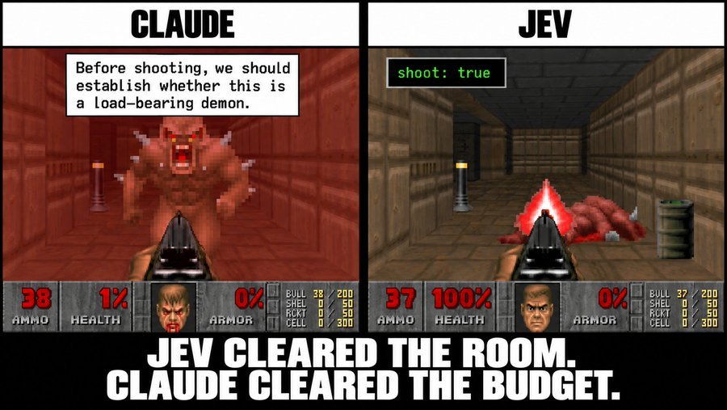

# TypeSafe/Jev: Fable research handoff

Saved 2026-09-16 for a Fable review next week. This records research and proposed experiments, not an accepted architecture change or authorization to train. Public sources were investigated during the conversation; this save pass does not independently revalidate them or current project execution status.

## Start here

1. Read this handoff for the conclusions and unresolved questions.
2. Read [the verbatim transcript](transcript.md) for every original user message, assistant answer, progress update, citation, and caveat through the save request. Original wording has not been corrected retrospectively.
3. Use [the JSONL transcript](transcript.jsonl) for exact message strings and individual SHA-256 hashes; [provenance](provenance.json) records the source session and image hashes.

The core hypothesis is that ADAM and Kaine may benefit from learning bounded decisions directly, with uncertainty, rather than expressing every decision through generated language. A second, overlapping hypothesis is that scoring the compatibility of complete candidate actions can capture dependencies that separate field predictions miss. Neither requires believing that Jev uses a world model, JEPA, or a particular energy-based training recipe.

## What the evidence supports

TypeSafe publicly presents Jev as a machine-facing decision model: Choice over finite candidates, Score over ordered levels, and Noul for a proposition probability. Its material names Reinforcement Learning for Calibrated Decisions (RLCD), a new architecture, and a parallel sampler, but does not expose enough training data, objective, initialization, optimizer, or sampler detail to reproduce Jev. Treat the public demonstrations as product evidence and research leads, not an independently reproduced benchmark.

- [Introducing System One Models and Jev](https://typesafe.ai/blog/introducing-system-one-models-and-jev)
- [Manifesto](https://typesafe.ai/manifesto), [Bitterest Lesson](https://typesafe.ai/blog/bitterest-lesson)
- [Documentation](https://docs.typesafe.ai/introduction), [documentation index](https://docs.typesafe.ai/llms.txt), [confidence semantics](https://docs.typesafe.ai/confidence)
- [Evaluations](https://evals.typesafe.ai/), [Python adapter](https://github.com/typesafe-ai/system-one-adapter-python)

Typed output prevents malformed output within the interface; it does not prove the selected answer is factually correct or an action is safe. Choice/Score distribution confidence is not automatically the probability that an entire action will succeed. Noul has a proposition probability, not an additional separate confidence output. The published workflow comparisons and frontier-model consensus targets need their stated scope retained.

The strongest direct lead about motivation was Almeida's own [What's Next After RLHF? talk and transcript](https://ai.engineer/talks/cJ0EOzey--o-whats-next-after-rlhf): around 14–17 minutes, he discusses reward pressure toward confident responses and calibrated decision-making as a different target. This supports an incentive-design explanation; it does not establish that the founders rejected superintelligence or identify an originating private OpenAI discussion.

## Avenue A: decisions without language generation

Train a model to map an observation, question, and supplied candidate descriptions to scores/probabilities. An arbitrary-label interface is more useful here than a fixed classifier whose labels are permanently baked into its head.

| Primary source | Concrete contribution | Limit for this project |
|---|---|---|
| [Building Efficient Universal Classifiers with Natural Language Inference](https://arxiv.org/abs/2312.17543) | Formulate classification as entailment against verbalized labels; transfer across tasks and labels. | Candidate evaluation has a cost; supported, contradicted, and unresolved evidence should remain distinguishable where needed. |
| [GLiClass](https://arxiv.org/abs/2508.07662), [implementation](https://github.com/Knowledgator/GLiClass) | Jointly encode text and dynamically supplied labels, pool representations, and score labels in one forward pass. Describes supervised and PPO training approaches. | A close public precedent, not evidence of Jev's architecture. Reported performance is not our measured ADAM performance or a calibration guarantee. |
| [LLM2Vec](https://arxiv.org/abs/2404.05961) | Adapt decoder models using bidirectional attention, masked next-token prediction, and contrastive learning. | Published scale differs from ADAM's smallest rung; changing an attention mask alone is not the complete method. |

For ADAM, first test a decision scorer while preserving the current backbone and engine contracts. A separate bidirectional conversion experiment should have its own evidence and cost accounting. For Kaine, investigate a shared representation with distinct decision and generative outputs while measuring whether either task degrades the other. Novel code, explanations, and open-ended content still require generation.

## Avenue B: compatibility and energy-based scoring

Score a candidate with an energy such as `E(observation, question, candidate)`; lower energy means greater compatibility. A finite-set softmax over negative energies is also ordinary classifier mathematics. Merely renaming logits as energies establishes no architectural novelty or calibration property.

The useful extension is to score **complete candidate actions**, including tool, operation, entity, arguments, and preconditions, so their dependencies are considered together.

| Primary source | Concrete contribution | Limit for this project |
|---|---|---|
| [A Tutorial on Energy-Based Learning](https://yann.lecun.org/exdb/publis/pdf/lecun-06.pdf) | General framework for learning compatibility rather than generating an answer. | A conceptual foundation, not a Jev recipe. |
| [Structured Prediction Energy Networks](https://arxiv.org/abs/1511.06350) | Learn dependencies among output variables and optimize structured predictions. | Inference/search can be expensive. |
| [Learning Approximate Inference Networks for Structured Prediction](https://arxiv.org/abs/1803.03376) | Train a network to approximate structured optimization. | Approximation quality and proposal coverage need testing. |
| [Implicit Behavioral Cloning](https://arxiv.org/abs/2109.00137) | Implicit policies can represent multi-valued and discontinuous action choices. | Robotics results do not establish transfer to software tool use. |
| [Joint Energy-based Model Training for Better Calibrated Natural Language Understanding Models](https://arxiv.org/abs/2101.06829), [code](https://github.com/salesforce/ebm_calibration_nlu) | Joint classifier/input-density energy training improves calibration on studied NLU tasks. | More than candidate ranking: includes noise-contrastive training and a noise model. No universal calibration guarantee. |

Construct meaningful alternatives: wrong entity, wrong operation, stale evidence, unmet precondition, several valid actions, and no adequate candidate. Do not train all unchosen alternatives as incorrect when several actions are valid. Include candidate construction, shortlisting, and search in latency/cost comparisons.

## Calibration and the OpenAI research trail

The user's hunch was that pressure to produce an answer can incentivize hallucination. The evidence is more specifically about reward/evaluation design than simply too much training.

- [Schulman's 2023 Berkeley talk](https://news.berkeley.edu/2023/04/24/berkeley-talks-transcript-chatgpt-developer-john-schulman/) discusses teacher/student knowledge mismatch, cloning confident answers, and an internal trivia experiment with correct/wrong/abstain rewards. The colleague and its relationship to TypeSafe were not established.
- [Teaching Models to Express Their Uncertainty in Words](https://arxiv.org/abs/2205.14334) demonstrates learned verbal uncertainty. It is a calibration precedent, not a non-generative interface.
- [Why Language Models Hallucinate](https://arxiv.org/abs/2509.04664) analyzes incentives favoring guesses over abstention. Pretraining also contributes errors; this is not a claim that reward changes eliminate all hallucinations.
- [Beyond Binary Rewards: Training LMs to Reason About Their Uncertainty](https://arxiv.org/abs/2507.16806), [project](https://rl-calibration.github.io/), describes RL with calibration rewards (RLCR). One studied reward is `c - (q - c)^2`, with correctness `c` and predicted probability `q`. RLCR is not TypeSafe's RLCD. Reward combinations need analysis; not every proper-scoring-rule combination has desirable policy incentives.
- [On Calibration of Modern Neural Networks](https://arxiv.org/abs/1706.04599) supplies temperature scaling as a baseline.
- [Can You Trust Your Model's Uncertainty?](https://arxiv.org/abs/1906.02530) motivates testing calibration under dataset shift rather than trusting in-distribution calibration alone.

Keep three questions separate: which offered action ranks highest; whether any offered action is adequate; and whether executing the chosen action will achieve the intended effect. A sharp closed-set distribution can confidently choose among entirely bad candidates.

## The memes and world models

The [Gafni post](https://x.com/EGafni/status/2099983724951789999) was recovered through the X syndication endpoint during research. Its caption was “the memes on our discord 🤣🤣”. It is not a technical architecture disclosure. The user has posted these two interpretations to Erik and is awaiting a response:

> Intelligence need not produce language to make decisions or Learn compatibility scores for possible outcomes instead of generating answers?

No response from Erik is recorded in this handoff. Preserve any future reply with its exact wording and context before updating the hypothesis.

A policy maps state to an action; a world model predicts consequences of state plus action. Jev returning `shoot: true` demonstrates action selection, not learned state-transition prediction. LeCun's [A Path Towards Autonomous Machine Intelligence](https://openreview.net/forum?id=BZ5a1r-kVsf) and [I-JEPA](https://arxiv.org/abs/2301.08243) are relevant neighboring research, but the meme does not establish that Jev implements them. A future Kaine experiment could compare predicted effects against verified effects; keep that experiment distinct from direct action selection.

Original attachments:

## Proposed comparison and Fable review

Compare four arms using the same observations, candidate sets, verifier, held-out task families, and explicit compute budgets:

1. Current constrained generation baseline.
2. Direct candidate/label scoring.
3. Joint scoring of complete candidate actions.
4. The strongest decision arm with an explicit calibration treatment, compared against temperature scaling alone.

Measure verified action and workflow success, semantic validity, candidate recall, Brier score/log loss, reliability bands, coverage versus error, appropriate and inappropriate abstention, recovery cost, total latency, and total compute. Include shuffled candidates, unfamiliar tool descriptions, changed identifiers, missing evidence, long contexts, and distribution shift. Separate calibration fitting from evaluation. No local model experiments or benchmark results were produced by this research conversation.

Read [ADR 110](../../decisions/110-kaine-character-guided-reward-live-environment.md), [ADR 111](../../decisions/111-kaine-architecture-ladder.md), and the [P7 plan](../../plans/2026-09-14-phase51-p7-kaine-architecture-ladder-and-training-engine.md) before proposing implementation. The research used those documents as design context, not proof of current rollout or training status. Preserve corrected siblings, zero imitation weight for failed actions, bounded weighted supervision, reward-vector dimensions, real environment verification, and engine authority. Do not silently substitute a policy-gradient experiment for the accepted weighted-SFT path.

Questions for Fable:

- Which minimal ADAM decision surface gives a fair and useful first test?
- Should the model score complete actions or factorized choices, and how are invalid combinations prevented?
- How are candidate omission, several valid answers, and insufficient evidence represented and labeled?
- Which probability is being calibrated, against which observable outcome?
- Can calibration supervision fit the current training plan, or does it require a separately reviewed experiment?
- Does candidate generation/search consume the apparent inference savings?
- Which Kaine decision/generation sharing arrangement preserves both capabilities?
- What new evidence would distinguish a Jev architecture claim from a plausible public precedent?

The practical next step is a bounded experiment specification after Fable review, not an attempt to reverse-engineer an undisclosed RLCD recipe from memes.

## Follow-up: temporal straightening and the Qwen inference prototype

Investigated later on 2026-09-16 after the user supplied [this paper post](https://x.com/HowToPrompt__/status/2100128683390636034) and [Niels Rogge's explanation](https://x.com/NielsRogge/status/2100239244501430438). These were not in the original research set. The verbatim transcript above remains the original frozen export through the save request.

### Temporal Straightening for Latent Planning

[Paper, arXiv:2603.12231](https://arxiv.org/abs/2603.12231), [author project](https://agenticlearning.ai/temporal-straightening/), [official code](https://github.com/agentic-learning-ai-lab/temporal-straightening/). Ying Wang and colleagues; LeCun and Mengye Ren are equal advising authors. First posted March 12, 2026; listed at ICML 2026.

The tweet reverses the main intervention. The authors learn a representation whose feasible temporal trajectories are straighter, improving Euclidean latent-distance planning, rather than rewriting all RL algorithms to operate in curved geometry. Their objective combines next-latent prediction with a curvature penalty, `1 - cos(z[t+1]-z[t], z[t+2]-z[t+1])`. Reported experiments concern goal-reaching tasks, including mazes and PushT. They do not establish that an AI already understands physics perfectly or that hallucinations are solved.

Proposed relevance: a separate Kaine action-conditioned world-model experiment could test whether learned distance reflects achievable progress. Straightening is not automatically appropriate for discrete software workflows with branches, reversals, and irreversible state changes. No evidence connects this method to Jev's implementation.

### Qwen-2.5-1B-RLCD: inspect implementation, not repository name

[Repository](https://huggingface.co/harshatheg/Qwen-2.5-1B-RLCD), inspected revision `2af86848be75847ccb3553b0941cc51d6ef7e4e9`. Despite its name, the model card describes parallel constrained inference using Qwen2.5-1.5B-Instruct (including an MLX 4-bit variant). The inspected file inventory contains application/inference code and no model weight files or RL training pipeline. This supports an inference prototype, not a verified reproduction of Jev or its proprietary RLCD.

The implementation prefills a shared context/schema, replicates its KV cache across field suffixes, evaluates those suffixes in a batch, selects candidate-token logits, applies softmax, and assembles JSON in code. That gives an immediate baseline for Avenue A with unchanged model weights. It does not establish Avenue B's joint action scoring or a world model.

Static inspection findings, not executed benchmark results:

- [PyTorch engine](https://huggingface.co/harshatheg/Qwen-2.5-1B-RLCD/blob/2af86848be75847ccb3553b0941cc51d6ef7e4e9/core/engine_torch.py) defaults to Qwen/Qwen2.5-1.5B-Instruct. Softmax with a default temperature of 1 is labeled calibrated, but this computation alone does not establish empirical calibration.
- It reports one sequential forward pass although the function calls the model for prefill and again for batched suffix evaluation. Memory/compute still scales with fields; it deep-copies and repeats the cache.
- [Schema compiler](https://huggingface.co/harshatheg/Qwen-2.5-1B-RLCD/blob/2af86848be75847ccb3553b0941cc51d6ef7e4e9/core/schema.py) detects candidate first-token collisions. The inspected PyTorch decision loop does not resolve them: duplicate candidate token IDs receive identical scores, making distinct choices indistinguishable in that case. Do not generalize this finding to every backend without checking it.
- [Baseline prompt](https://huggingface.co/harshatheg/Qwen-2.5-1B-RLCD/blob/2af86848be75847ccb3553b0941cc51d6ef7e4e9/core/prompt_builder.py) explicitly asks for indented multi-line JSON. Published speedups should be remeasured against a compact constrained-generation baseline, with quality and total costs included.

Fable follow-up priority: use the Qwen design as a cheap no-training control for bounded decisions, after addressing token collisions and calibration measurement. Keep temporal straightening as a distinct future world-model hypothesis. Neither link reveals TypeSafe's training recipe.

The subsequent user-visible discussion is preserved verbatim in [the follow-up transcript](follow-up-transcript.md), with [exact message strings and hashes](follow-up-transcript.jsonl).
