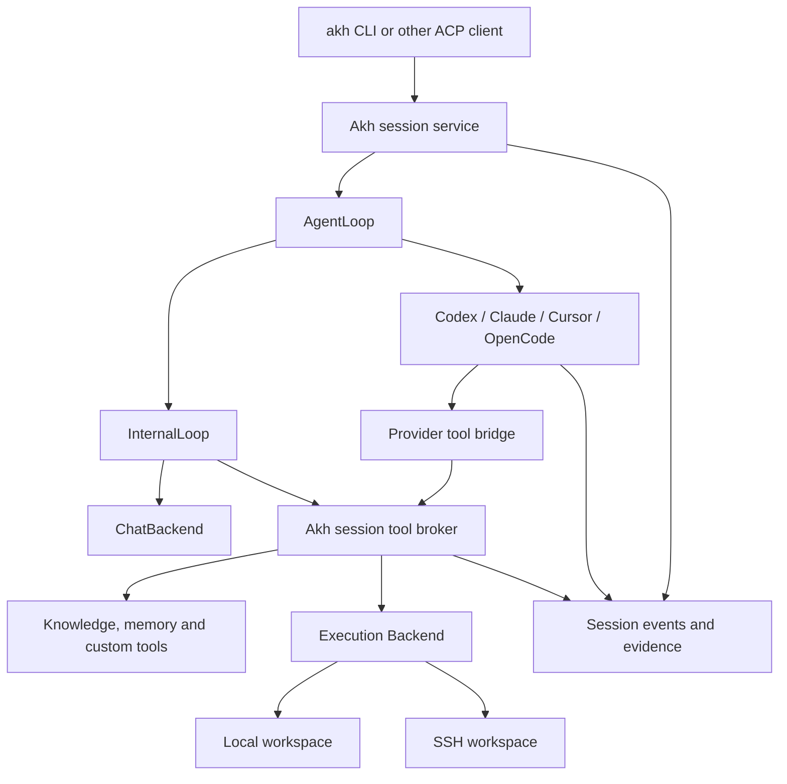

# Interchangeable agent loops: architecture for discussion

Date: 2026-09-09. Status: **proposal, not an accepted ADR or implemented contract**.
Parent: [Wayfinder map](../map.md). Decision detail belongs to the linked tickets.

2026-09-11 deployment target: see the researched
[Kubernetes, ACP/WSS, kagent and upstream T3 Code plan](k8s-acp-t3-deployment.md)
for application/session ownership, remote runtime helpers and sandbox workspace
integration. Sessions are central; selectable editor servers run beside the
executor in their sandbox. [Anima routing migration](sandbox-images-anima.md)
traces the simplification this permits. AG-UI is optional.
The latest [upstream-service constraint](upstream-services-tool-bindings.md)
keeps external releases unmodified and puts launch/config/login automation and
semantic tool bindings in Akh helpers, with a shared profile model.

2026-09-10 follow-on: the user selected a daemon split and the names
`akhsessd`, `akhrtd`, `akhsbxd`, `akhexecd` and `akheventd`, with ACP/AG-UI at
the session boundary. The [daemon-boundary addendum](daemon-boundaries.md)
expands sections 2 and 8 below and traces the current Codex/Claude prototype,
Djehuty ingress, automations and sandbox provisioners into that proposal.
Detailed policies remain under discussion. This local addendum has not updated
the published Anima document or native plan records.

The user has accepted this boundary: a provider runtime may own its internal
agent loop, while Akh owns the session experience, valuable tools, memory,
workspace abstraction and execution backend. Internal, Codex, Claude, Cursor
and OpenCode are intended loop implementations. Listing an implementation here
does not assert its provider integration or subscription eligibility is proven.

## 1. Four independent choices

| Concept | Responsibility | Examples |
| --- | --- | --- |
| Akh | Identity, persona, authorized knowledge and memory | Thoth, Tecton |
| Agent loop | Drives a task through model decisions and tool requests | Internal, Codex, Claude, Cursor, OpenCode |
| Model backend | Produces a model response inside a loop | Ollama, Candle, OpenAI API; provider-managed choices inside external loops |
| Execution backend | Performs workspace filesystem and process operations | In-process, local privilege drop, SSH remote |

The client is a fifth, independent concern: the lean `akh` binary, an editor,
or another ACP client connects to Akh's session service. Choosing a different
client does not select another tool authority, model credential or execution
target.

**Accepted selection rule:** one loop implementation is fixed for each Akh.
Every session of that Akh uses its configured loop; clients cannot override it
per session. Different Akhs may use different loop implementations. Each
session still has its own loop instance, conversation and provider session ID;
sharing a loop implementation does not share conversation state.

Changing an Akh's configured loop while sessions exist is a separate lifecycle
decision. Recommended, not yet accepted: require all sessions to be closed
before changing the loop. See [Session ownership and loop selection](../tickets/session-ownership.md).

## 2. Component boundary



The provider bridge converts wire protocols and tool schemas. It does not
become a second permission engine or execution backend. Provider credential
handling stays in the official runtime. Akh owns its own client authentication
and executor credentials; these are separate identities.

An MCP capability is not sufficient evidence that all provider execution is
redirected. Native reads, shell, edits, hooks, plugins, other MCP servers and
subagents can each bypass the bridge unless disabled, intercepted or confined
using a verified provider mechanism. See [execution ownership](../tickets/execution-boundary.md).

## 3. What the trait represents

`ChatBackend` remains the one-response model interface inside `InternalLoop`.
`AgentLoop` represents the full session driver, including waiting for input,
one or more model/tool rounds, cancellation and terminal outcomes. It must not
require outside loops to expose individual model steps or hidden reasoning.

One possible **object-safe, synchronous driver sketch** follows. Supporting
types are illustrative, not a new public API. A factory registry creates an
instance per session; a session worker drives it. Async provider adapters can
own their runtime behind this seam without making every existing Akh tool async.

```rust,ignore
pub trait AgentLoop: Send {
    fn descriptor(&self) -> &LoopDescriptor;

    // Consumes one instance for one bound session. Control reception and
    // tool replies must keep progressing while provider output is pending.
    fn drive(
        self: Box<Self>,
        session: LoopSessionContext,
        io: LoopIo,
    ) -> Result<LoopExit, LoopError>;
}

pub enum LoopCommand {
    Submit(TurnRequest),
    AnswerApproval(ApprovalReply),
    AnswerInput(InputReply),
    Interrupt(TurnId),
    Close(CloseReason),
}

pub enum LoopEvent {
    Ready(LoopBinding),
    TurnStarted(TurnId),
    TextDelta(TextDelta),
    ToolRequested(ToolRequest),
    ToolProgress(ToolProgress),
    ToolFinished(ToolReceipt),
    ApprovalRequired(ApprovalRequest),
    InputRequired(InputRequest),
    UsageUpdated(UsageObservation),
    TurnFinished(TurnOutcome),
    Exited(LoopExit),
}
```

`LoopIo` needs bounded command/event channels and a tool-reply path. Exactly
one broker invocation handles each `ToolRequested`; observing the event in a
client does not execute it again. The driver translates the resulting receipt
back to the provider's outstanding request. Interrupt/approval messages must
not queue behind a blocked `Submit` handler. Terminal outcomes and receipts
must never be silently dropped under backpressure; text deltas can be coalesced.

The loop contract must choose whether approval/input wait states are explicit
states or a pending-request set; this sketch does not lock that decision.
Errors use the repo's typed `thiserror`/`miette` conventions. Do not return an
empty string or `None` for auth failure, unsupported capability or lost session.
See [AgentLoop contract and lifecycle events](../tickets/loop-contract.md).

## 4. Session service and authority

Proposed session data: Akh identity, authenticated owner, loop configuration
snapshot, provider binding, executor binding, tool catalogue revision, client
attachments, active turn, pending approvals, event cursor, and resumability
status. Secrets are references or provider-owned state, not fields in events.

Distinguish these identifiers: Akh ID, Akh session ID, turn ID, provider session
ID and tool invocation ID. A provider ID is scoped to its provider account,
installation and runtime location. It is not an authorization token and does
not let an arbitrary client attach. A shared Akh is not a shared conversation.

Recommended initial concurrency rule: one active turn and one controlling
client per session; additional authorized observers may consume events.
Changing controller needs explicit transfer; stale clients cannot answer
new approvals. Different sessions may execute concurrently but shared-worktree
writes need the existing coherence policy or explicit worktree isolation.

Client reconnect, provider resume and execution-target reconnect are separate
operations. A successful client attach says nothing about whether the provider
can resume or whether an interrupted remote command stopped. Durable session
storage and event replay are decisions still to make: current ACP state is
bounded and retained in memory, not a daemon-restart guarantee.

## 5. One tool route and three different locations

The design must distinguish **client cwd**, **provider process cwd** and
**executor workspace cwd**. On a distributed installation these can be three
different filesystems. Remote paths must be validated/resolved through the
bound executor, not by calling local `canonicalize()` on the daemon.

For example, a Codex process on the daemon asks for `file_io` on a path in the
session workspace. Akh checks the session's advertised tool, policy, and
execution binding, routes to `RemoteBackend`, and returns the remote result.
The model does not construct an SSH command and cannot choose a local target
as a per-call argument. File reads, edits, searches and commands target the
same workspace. Knowledge/memory tools may run in Akh or their authorized
upstream services; they are not forced onto the SSH host.

The tool broker must carry explicit immutable session context: authorization,
tool catalogue, executor, cwd, request IDs, cancellation and evidence sinks.
Today's registry overlays and cwd are thread-local within `spawn_blocking`.
An async SDK callback on another thread will not inherit them. Migration must
either marshal every invocation to the correct worker or replace these ambient
dependencies with explicit context before parallel callbacks are enabled.

Tool names and schemas come from the existing registry, including authorized
client-pushed MCP tools. Discovery/paging may limit the prompt catalogue, but
must not hide tools permanently or grant capabilities outside the session.
Catalogue changes require a revision/renegotiation rule; provider resume must
not silently resurrect a tool whose authorization was revoked.

Execution profiles must be explicit. The desired default is exclusive Akh
execution. A provider which cannot meet it reports incompatibility for that
session/backend before work starts. A future mode exposing provider-native
tools would need its own user decision and accurate weaker guarantees.

## 6. Cancellation and execution evidence

An interrupt requests provider stop and prevents new broker invocations.
Already-running operations also receive cancellation via their execution
backend. Receipt states must distinguish succeeded, failed, denied, cancelled
with confirmation, and outcome unknown. SSH channel closure or a provider
process exiting does not prove that a remote process has stopped.

Do not promise exactly-once execution after a crash. Persist correlation and
invocation state where required, deduplicate repeat callbacks in the known
session, and reconcile uncertain side effects before retrying. A duplicate
provider notification is not permission to execute the same mutation twice.

A provider's terminal answer is a candidate result. Akh's completion controller
accepts it only with required host-observed evidence. Keep provisional streamed
text distinguishable from accepted completion; a pleasant final sentence or
provider exit code alone does not satisfy an execution contract.

## 7. Memory, context and billing

Akh remains authoritative for persona, durable knowledge, accepted transcript,
provenance and execution receipts. External loops retain their private model
conversation, compaction and provider-specific context. Akh supplies a scoped
initial briefing, current-turn information and retrieval tools. Its context
manager must not independently truncate/replay the provider's hidden history.

Transcript retention, memory writes and cross-session visibility need explicit
policies; same-Akh membership does not erase user/session access boundaries.
Provider-private reasoning need not be recorded. Tool output may contain
credentials or private data and needs the existing redaction/retention policy.

Record the selected authentication/billing mode and observed usage separately.
Unknown token usage/cost is unknown, not zero. Subscription availability does
not imply unlimited usage or API credits. On quota exhaustion or auth expiry,
report a typed recoverable state; never switch account or silently incur API
billing. Credentials and refresh remain with supported provider mechanisms.

A transfer to an Akh using another loop would export an explicit authorized
briefing/history selection into a new provider binding; its policy is still open. It cannot transfer hidden caches or imply an
exact continuation. See [Memory, transcript continuity and provider usage](../tickets/context-continuity.md).

## 8. Clients and provider transports

Keep ACP as Akh's inbound session protocol. The `akh` binary stays lean and
does not acquire provider SDKs. Standard session/new, prompt, load, cancel and
updates remain the compatibility baseline; negotiate Akh extensions for Akh
selection, configured-loop visibility, capability reports, execution bindings and any event replay/control
features that ACP does not already represent. Wire names are to be decided,
not invented as existing standard methods in this draft.

Provider transport is an implementation detail: app-server JSON-RPC, an SDK
bridge, server API, subprocess or an ACP client connection. If a provider speaks
ACP, Akh is its client while Akh remains an agent/server to the outer client.
These two protocol connections must not recursively forward session creation.

Client-pushed MCP servers are **inbound tool sources**. The provider bridge is
an **outbound tool exposure** of the session registry. Reuse tool manifests and
policy, not an unauthenticated global MCP endpoint. Stdio/in-process bridges
can inherit session authority without network credentials; remote bridges need
short-lived, session-scoped authentication and revocation. No provider callback
may assert an arbitrary Akh/session identity.

See [Akh and external clients attach to the same session service](../tickets/client-contract.md).

## 9. Different kinds of loops

Yes: the trait should permit different algorithms as well as different vendors.
The common contract is task/session lifecycle and observable requests/results,
not a requirement to do ReAct or produce one tool call per model response.

| Loop type | Possible implementation | What Akh can control |
| --- | --- | --- |
| Reactive model/tool loop | Existing `InternalLoop` | Model backend, round policy, context strategy |
| Plan then execute | Internal strategy, or distinct loop if lifecycle differs | Plan checkpoints and approval conditions |
| Iterative research | Internal strategy with evidence-based stopping | Retrieval, evidence accumulation and stop criteria |
| Deterministic workflow | Separate `AgentLoop` implementor; model optional | Explicit transitions and tool requests |
| Provider-native coding loop | Codex/Claude/Cursor/OpenCode adapter | Only advertised provider controls plus Akh tools and outer policy |
| Delegated or review-and-revise work | Outer coordinator over child sessions | Budgets, child authority, dependency/result aggregation |

Avoid a new trait for every prompt preset. Two internal strategies may share
one `InternalLoop` implementation if their lifecycle is identical. A provider's
opaque strategy is not selectable merely because Akh has a strategy field.
Reject unsupported combinations explicitly. A persona is not a loop strategy.

Composition should be capability-gated and bounded: parent and child session
IDs, authority narrowing, cancellation propagation, budgets and worktree policy
must be explicit. A recursive tool that calls the same busy session can deadlock;
delegation creates a distinct child session. These are open decisions, not an
instruction to build a multi-agent scheduler in this map.

See [Different loop strategies and composition](../tickets/loop-strategies.md).

## 10. Current code versus target

| Current seam | Evidence | Implication |
| --- | --- | --- |
| `ChatBackend` returns `AssistantTurn` | `src/agent/chat_backend.rs` | Retain as the internal loop's model interface |
| Native loop has an early runtime branch | `src/agent/agentic_chat.rs`; uncommitted prototype | Replace branching with an Akh-configured loop factory creating isolated session instances |
| `AgentRuntime` is a concrete Codex/Claude enum wrapper | `src/agent/runtime.rs`; uncommitted prototype | Reuse transports; refactor common session service out of provider-specific turn handling |
| Runtime choice and model/set mutate shared Agent | `src/agent/agent.rs`, `src/bin/akhomed.rs` | Loop selection remains Akh-scoped; changes must obey the decided session lifecycle policy |
| Provider identity is skipped by serialization | `src/agent/conversation.rs` | No restart-resume claim today |
| ACP session state and one-turn guards already exist | `src/acp/mod.rs` | Extract/reuse lifecycle ownership and avoid duplicate session registries |
| Session tools/approvals/cwd are worker-thread scoped | `src/acp/mod.rs`, `src/agent/tool.rs`, `src/fs/mod.rs` | Cross-thread provider callbacks need explicit marshalling/context |
| `Backend: Filesystem` and a remote implementation exist | `src/backend/mod.rs`, `src/backend/remote.rs` | Preserve the executor seam; do not infer deployed SSH conformance from source presence |
| Native provider tools still execute locally | `src/agent/runtime/codex.rs`, `scripts/agent-backends/claude.mjs`; prototype | Keep the current remote-executor guard until exclusive routing is proven |

Code inspected at base `af7a154a` plus the existing uncommitted runtime prototype.
These are local source observations, not current deployment claims. Older ADRs
describe designs that have since evolved; code is the implementation evidence.

Provider research assets:

- [Codex and Claude](codex-claude.md): official tool callbacks and lifecycle
  interfaces, subscription/binary versus SDK distinctions, execution-exclusion
  controls and their documented limits.
- [Cursor and OpenCode](cursor-opencode.md): Cursor's ACP and SDK Bridge,
  OpenCode's server/ACP surfaces, tool restriction candidates, configuration
  inheritance and a concrete directory-scoped MCP isolation concern.

These findings support provider-specific adapters with negotiated capabilities.
None of the four external providers has passed the exclusive Akh/SSH execution
conformance gate in this map. The prior Codex/Claude custom-tool smoke tests
demonstrate a narrower capability.

## 11. Candidate migration sequence and conformance bar

This sequence is input to the [handoff decision](../tickets/handoff.md), not a
set of implementation work items ready for dispatch.

1. Decide session binding, ownership and minimum lifecycle contract; lock terminology.
2. Wrap the existing native loop as `InternalLoop` with equivalent observable
   behavior, preserving existing clients, context policies and completion gates.
3. Introduce the session tool broker and provider adapters behind capability
   checks; preserve typed schemas, approvals, evidence and executor routing.
4. Prove Codex/Claude exclusive execution and supported authentication. Cursor
   and OpenCode enter when their specific research and conformance gates pass.
5. Expose the Akh-configured loop to clients and reject session overrides; migrate legacy `backend`
   configuration without changing billing, execution location or existing sessions.
6. Add persistence/reconnect or alternative strategies only to the scope the
   decisions establish. Expand conformance for those features before advertising them.

Minimum meaningful checks: concurrent sessions of one Akh use the same loop
with isolated state; different Akhs can use different loops; per-session loop
overrides are rejected;
unchanged native-loop behavior; schema fidelity and revoked-tool rejection;
approval identity and duplicate-request handling; file/search/edit/exec on one
SSH target with positive remote receipts and an unchanged local canary;
native-tool/hook/subagent bypass attempts; timeout/cancel and unknown remote
outcome; provider crash, auth expiry and quota errors; lost resume state;
client disconnect during approval; completion-contract refusal without evidence.

Each capability report records adapter/provider version and observed limits.
Unsupported, unknown, configured and live-verified are different states.
