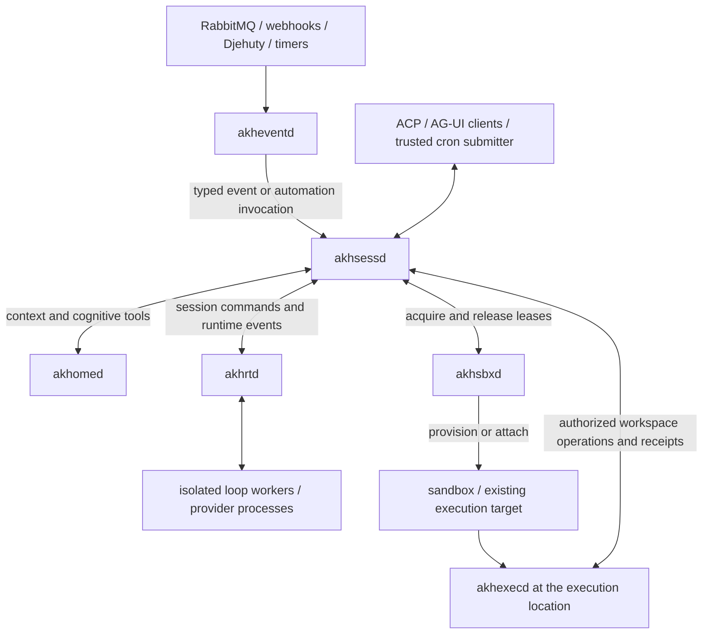

# Daemon boundaries, event ingress, automation and provider migration

Date: 2026-09-10. Status: **design addendum; no daemon implementation or deployment**.
Parent: [agent-loop map](../map.md), [architecture draft](architecture-draft.md).

2026-09-11 deployment refinement: the
[Kubernetes/ACP-WSS/kagent/T3 plan](k8s-acp-t3-deployment.md) keeps sessions central
in `akhsessd`, prioritizes ACP/WSS, and co-locates a selectable T3/VS Code/Zed
remote server with `akhexecd` in the sandbox. Runtime placement remains
independent. The [image/Anima trace](sandbox-images-anima.md) explains the
resulting reduction in Anima routing responsibilities. These deployment
findings qualify the initial topology below.

## Decision status

The user selected these names and responsibilities: `akhsessd` for client-facing
sessions, `akhrtd` for loop runtimes, `akhsbxd` for sandbox management,
`akhexecd` for execution and workspace files, and a small `akheventd` for
RabbitMQ/webhook events delivered into sessions. `akhomed` remains the Akh core.
The earlier accepted rule, one loop implementation fixed per Akh with isolated
session state, remains in force. ACP and AG-UI belong at the session boundary.

The user also requested tracing the existing Codex/Claude integration into this
split. The detailed automation ownership, delivery policies, IPC contracts and
migration order below are recommendations for review, not additional accepted
decisions. Names of proposed types and commands are illustrative.

This is a local addendum. It has not updated the Anima Plan, Work Items, or
published architecture document. The earlier draft's single-daemon/client-only
scope is expanded here for design discussion; implementation dispatch remains
outside this document.

## 1. Owners and dependencies

| Process | Owns | Boundary |
| --- | --- | --- |
| `akhomed` | Akh configuration/persona, durable knowledge and memory, symbolic services, residency/WAL/snapshots, native cognitive tools | Does not host GUI transports, provider processes, external input polling or wall-clock session automation after migration. Internal storage maintenance stays here. |
| `akhsessd` | Authenticated sessions, ACP/AG-UI, controller/observer attachments, automation definitions and run admission, pending input, ordered session events, completion acceptance | Selects the configured Akh; coordinates services without running provider loops or workspace shell commands. |
| `akhrtd` | Runtime installation/capabilities, scoped worker supervision, provider connections, native request/event adaptation | Executes the loop selected by the Akh configuration. Reports facts; cannot grant its own tool permissions or declare host execution evidence. |
| `akhsbxd` | Provisioner drivers, sandbox profiles, allocation/leases, readiness, retention and cleanup | Acquires or attaches an environment, returns a verified binding, and reconciles resources after failure. No per-tool shell execution. |
| `akhexecd` | Workspace attachment/materialization, files/search/edits/processes, operation cancellation and receipts | Runs at the bound execution location with its OS identity. Has no provider credentials or sandbox-provisioning authority. |
| `akheventd` | Source connections, validation/normalization, durable ingress, routes and delivery retries | Sends typed inputs to `akhsessd`; no LLM, engine hydration, session state machine or implicit remediation. |

`akhrtd` is a supervisor/service, not one shared conversation. It owns isolated
workers for sessions; their loop implementation is inherited from the Akh.
External providers are the first worker candidates. Internal inference may need
shared model serving to avoid duplicating large models in every session worker.

These are process and dependency boundaries, not a requirement for six machines
or a Kubernetes installation. A local installation can supervise the services
on one host over authenticated local IPC; distributed installations can place
runtime workers and executors near their workspaces. To make `akhomed` smaller
in build size as well as responsibility, extract crates so it no longer links
provider adapters or GUI transports. New binaries importing the entire engine
crate would not achieve that dependency reduction.



The session tool broker merges catalogs, routes calls, correlates results and
coordinates human input. Each service enforces the scope of the operations it
performs. Native knowledge tools execute in `akhomed`; workspace tools execute
through `akhexecd`; client tools return to the controlling client. Authorized
MCP adapters are session-scoped tool providers, not new global capabilities.
Provider tool callbacks return through this broker. Observing a tool event does
not execute it again.

Anima continues to own its work-item scheduling, review gates and tracked runner
assignments. Trigger admission must respect that owner; an alert must not start
a second implementation session for a work item that Anima already controls.

## 2. Who manages automations and receives session input?

Recommendation: distinguish the clock/source, the automation definition, and
the resulting session work.

| Concern | Owner |
| --- | --- |
| Wall-clock schedule | Existing cron, launchd/systemd timer or Kubernetes CronJob; optional built-in timer source for standalone compatibility |
| RabbitMQ/webhook/Board subscription | `akheventd` source adapter |
| Event matching and destination route | `akheventd`, using an authorized, versioned route |
| Automation definition, enablement, input template, target policy, budgets and run ledger | `akhsessd` |
| Admission, session creation/reuse, busy-session queue and pending human input | `akhsessd` |
| Agent execution | `akhrtd` worker |
| Knowledge conditions and storage maintenance | `akhomed`; a condition requiring agent work emits a typed event |
| Deterministic workspace monitoring | Appropriate executor-side monitor; reports events without requiring a model |

An `AutomationDefinition` contains its Akh, trusted instruction template,
authorized input sources, tool profile, session-target policy, sandbox profile,
concurrency, expiry/misfire handling, budget and optional reply destination.
Trigger events supply data; they cannot replace that definition or widen it.

External schedulers are first-class trigger producers. A trusted submitter can
call `InvokeAutomation(automation_id, occurrence_id, input)` on `akhsessd`
directly. Webhooks and broker messages normally enter through `akheventd`.
Authorized clients can also create a session or append input through the same
session API. Neither path may write the session database directly.

Prefer a configured automation ID over giving cron an unrestricted prompt and
provider/sandbox selector. One logical occurrence has a stable key such as
`automation-id + scheduled-time`; job retries reuse it. A transport retry and a
deliberate new model attempt have different identifiers and policies.

Kubernetes documents approximate CronJob scheduling and requires idempotent
jobs: [CronJob limitations](https://kubernetes.io/docs/concepts/workloads/controllers/cron-jobs/#job-creation).
Its job concurrency policy does not bound an asynchronous session that keeps
running after the submitter Job exits. Session-level overlap limits therefore
belong in `akhsessd`. Submission success means accepted input, not completed work.

Keep one active clock owner per automation. An optional `TimerSource` in
`akheventd` can reuse the existing once/interval/cron calculation for standalone
installations. It emits occurrences only; it does not run models. Select either
that driver or an external scheduler, and preserve timezone/misfire semantics
when migrating. Do not run the old resident timer and new clock simultaneously.

## 3. Delivery into existing and new sessions

Separate target selection from what an input does:

| Dimension | Proposed choices |
| --- | --- |
| Target | Explicit authorized session; new session per occurrence; find-or-create by stable conversation key; per-incident session keyed by alert fingerprint |
| Effect | Record/notify without a model run; enqueue a turn; explicitly supported steering/interrupt |
| Busy policy | Queue by default; coalesce configured state updates; reject; interrupt only under an explicit rule and supported runtime capability |
| Unattended policy | Run within the configured tool profile; hold for authorized approval/input when needed; expire explicitly |

For Board threads, a conversation key should include Board instance, thread,
Akh and authorized principal. For alerts, include the source and incident
fingerprint so firing/resolved updates reach the same authorized conversation.
Find-or-create must be atomic to prevent duplicate sessions from concurrent
deliveries. A request for an expired explicit session must not silently create
another session unless its configured policy permits that behavior.

Within `akhsessd`, one logical session owner orders client commands and event
deliveries and admits at most one active turn by default. Runtime commands and
results carry turn IDs and ownership generations; stale workers cannot append
to a newer turn. Journal accepted input before dispatch, and use resumable event
cursors for clients. GUI disconnection does not by itself cancel an automation;
cancel, detach and stop-on-disconnect are distinct policies.

Store event input with its real origin. Today `run_runtime_turn` records every
incoming prompt as an operator turn; the shared `TurnInput` must distinguish
human input, automation instructions and external event data before this path
accepts events. Board messages or alert descriptions must not become trusted
system instructions or approvals. Source authentication establishes origin,
not authority for whatever text the event contains.

## 4. Small internal event schema

One bounded envelope plus application-owned payloads is sufficient initially:

```json
{
  "schema_version": 1,
  "id": "alertmanager:cluster-a:fingerprint-123:firing:2026-09-10T12:00:00Z",
  "source": "alertmanager/cluster-a",
  "type": "alert.firing",
  "occurred_at": "2026-09-10T12:00:00Z",
  "subject": "service/payments",
  "correlation_id": "incident-fingerprint-123",
  "data": {
    "severity": "critical",
    "summary": "Error rate exceeded the configured threshold",
    "labels": {"environment": "staging"}
  }
}
```

`causation_id`, content/schema metadata and artifact references can be optional.
The authenticated principal, receive time, payload digest and delivery attempt
are recorded by ingress rather than trusted from the payload. Route selection
is separate from the event: configured source/type matching resolves an allowed
automation or destination. A submitted session identifier is only a requested
target and must still be authorized. Broad payload extensibility does not grant
arbitrary routing or tool execution.

Event identity includes its logical source. Repeating an ID with different
content is a conflict, not a silent overwrite. Large logs/files become scoped
artifact references; they are not copied into every session or unconditionally
downloaded from an event-supplied URL. Externally received events and internal
runtime lifecycle events share correlation conventions, not trust levels.

Keep `akheventd` deterministic and small: adapter, normalize, validate, persist,
route, retry. It needs durable receipt/delivery state or an equivalent broker
handoff. It does not need an engine, provider SDK or general workflow language.

For RabbitMQ, acknowledge after durable ingress acceptance and recording the
necessary delivery work, or after a durable downstream acceptance if no local
inbox is used. Webhooks return success at that same acceptance boundary. A
crash after acceptance replays deliveries with stable keys. Fan-out stores a
delivery key per destination and route revision; one failed destination does
not duplicate successful recipients. Malformed or exhausted deliveries become
inspectable rejected/dead-letter records. Receipt, session admission, turn
completion and external reply delivery are distinct outcomes.

## 5. Djehuty and existing reactor migration

Current implementation references:

- [`djehuty.rs`](../../../../src/agent/djehuty.rs): typed Board client, identity,
  replayable pagination, idempotent posting and checkpoint support.
- [`board_reactor.rs`](../../../../src/agent/board_reactor.rs): durable fan-out
  cursors, own-message filtering, bounded event payloads, tool-free replies and
  stable reply keys.
- [`reactor.rs`](../../../../src/agent/reactor.rs): once/interval/cron/event
  schedules, durable pending events, leases, retry/misfire state and actions.
- [`daemon.rs`](../../../../src/agent/daemon.rs): currently polls the Board and
  directly runs scheduled LLM turns, Board replies and deterministic actions.
- [`AutonomyConfig`](../../../../src/akh_config.rs): current master-off default
  and per-task overrides; migration must preserve effective gating, including
  explicit task overrides, rather than replacing it with a different boolean.

Move the Board ingress adapter/cursors to `akheventd`; move session automation
definitions and attempts to `akhsessd`; run model work through `akhrtd`.
Move clock calculation to an optional timer source or replace it with an
explicit external clock. Keep core maintenance in `akhomed`. Deterministic
training monitors must continue working without an LLM or a GUI connection.

Current cursor advancement and reactor enqueueing share the engine storage
boundary. Process extraction breaks that transaction unless deliberately
replaced. Use a durable ingress inbox plus per-destination outbox, downstream
deduplication and a checkpointed migration; do not advance the Board cursor on
an in-memory send. Preserve pending events, active claims, scheduled timestamps,
cached model results and reply idempotency keys during cutover.

Board adapters use the authorized identity for their subscription. They never
borrow another agent's identity. Preserve own-message suppression, allowed
message types, reply rate limits and loop/cause controls. Receiving a Board
message is not permission to post a reply. An enabled, authorized reply
automation is the source of that authority.

Automated Board replies retain their existing tool-free semantics by default.
The model produces a candidate response; after acceptance, a scoped Board
connector posts it using a stable key. If posting fails, retry the delivery
using the cached accepted result rather than rerunning the model. The connector
can remain a broker-accessible tool/service; `akheventd` need not grow an
outbound agent workflow. Direct event-triggered privileged work requires its
own configured automation policy.

## 6. Sandbox lifecycle versus workspace execution

`akhsbxd` accepts a profile-based `SandboxRequest`, validates resource and
identity policy, allocates/attaches the environment, and returns a
`SandboxLease` with a verified executor binding. Suggested operations are
`Acquire`, `Inspect`, `Renew` and `Release`; reset/snapshot/suspend are negotiated
capabilities rather than universal promises.

The lease carries opaque provider/resource identity, owner, generation,
expiry, execution posture, workspace retention policy and endpoint references.
`akhsessd` owns the association to a session. `akhsbxd` owns the resource's
lifecycle. `akhexecd` owns the workspace and running operations inside it.
Commands carry a lease generation so revoked/replaced instances cannot accept
stale work. Provisioning Ready and an authenticated, compatible executor
handshake are separate requirements before execution starts.

Provider options include Kubernetes Agent Sandbox and attachment to the
existing local-drop/SSH execution paths. The latter establish execution
location/identity; they do not inherently provision disposable isolation.
Existing in-process execution must continue to report its actual unconfined
posture. Containers/VMs/zones may become additional provisioner drivers, but
this document does not claim those integrations already exist.

The Kubernetes SIGs [Agent Sandbox project](https://github.com/kubernetes-sigs/agent-sandbox)
provides Sandbox resources and template/claim/warm-pool abstractions suitable
for a provisioner adapter. Keep those API details behind the driver and pin a
tested version. Its [threat model](https://github.com/kubernetes-sigs/agent-sandbox/blob/main/docs/security/threat_model.md)
explicitly assigns workload isolation to the configured runtime; a Sandbox
resource's existence is not itself proof of VM/kernel isolation.

Run `akhexecd` within the allocated environment or on the bound existing host.
Move the current file/exec backend implementations behind its protocol while
retaining their identity, cwd and containment semantics. It should handle
workspace files, checkout/worktree materialization, commands and streamed
results. Provisioner API credentials stay with `akhsbxd`; provider login stays
with the runtime; the executor receives only its scoped operation authority.

Separate environment lifetime from workspace-data lifetime. Release may delete
ephemeral compute while retaining an explicitly persistent volume/worktree.
Cleanup must verify ownership and active operations; failures remain visible
to reconciliation. Existing SSH targets are released, not destroyed. Claims
that a command stopped require executor/provider evidence; a dropped connection
or requested sandbox deletion can leave the outcome unknown.

## 7. Codex and Claude integration trace

The source below is the current **uncommitted prototype**, inspected on
2026-09-10. This addendum does not claim it is deployed or rerun its tests.

| Current responsibility/source | Destination | Required change or preserved behavior |
| --- | --- | --- |
| `RuntimeKind`, `RuntimeConfig`, provider selection in [`runtime.rs`](../../../../src/agent/runtime.rs), [`akh_config.rs`](../../../../src/akh_config.rs) | Shared descriptors; configuration authority in `akhomed`, resolved binding in `akhsessd` | Keep one implementation fixed per Akh. `akhrtd` reports supported installations; clients/events do not override the loop. |
| `Agent::run_runtime_turn` | Split across `akhsessd`, `akhrtd`, `akhomed` | Session admission/history/completion move to `akhsessd`; briefing and memory retrieval remain core services; provider driving moves to runtime workers. Replace direct Engine/ToolRegistry references with service calls. |
| [`codex.rs`](../../../../src/agent/runtime/codex.rs) | Codex worker under `akhrtd` | Retain app-server stdio initialization, thread/start or exact thread/resume, turn/start, tool callbacks, native approvals and interrupt translation. |
| [`claude.rs`](../../../../src/agent/runtime/claude.rs), [`claude.mjs`](../../../../scripts/agent-backends/claude.mjs) | Claude worker and SDK bridge under `akhrtd` | Keep SDK streaming input, exact resume ID, in-process MCP tool server, canUseTool callbacks and structured terminal result. |
| Codex dynamic tools and Claude SDK MCP tools | Provider adapter in `akhrtd` -> broker in `akhsessd` | Preserve schemas and advertised-tool restriction. Native cognitive calls go to `akhomed`; files/commands go to `akhexecd`; client tools and authorized MCP tools retain scoped handlers. |
| `Turn::approve`, `AcpPermissionAsker` | Normalization in `akhrtd`; pending request and human response in `akhsessd` | Preserve option/request IDs. The provider or event source cannot synthesize authorization. Deadline/cancel responses return to the original pending request. |
| `ConversationState.runtime_session` | Binding record in `akhsessd`; private provider state in its runtime | Preserve exact resume and account/runtime-location scope. Failed resume never silently starts a new provider session. Current bindings do not survive daemon restart. |
| Persona/context retrieval and accepted-turn WAL | `akhomed` with typed briefing/accepted-turn APIs | Keep credentials and private provider reasoning out of shared events. Preserve origin of event inputs and idempotent accepted-turn delivery. |
| `CompletionController`, dispatch tool trace | Completion acceptance in `akhsessd` using core/executor receipts | Keep candidate text distinct from accepted completion. Provider-native progress is not an Akh execution receipt. |
| [`process.rs`](../../../../src/agent/runtime/process.rs) | `akhrtd` worker supervisor | Retain bounded frames/queues, deadlines, stderr treatment and Unix process-group cancellation. Local process-group cleanup is not proof of remote execution termination. |
| Executor guard in [`akhomed.rs`](../../../../src/bin/akhomed.rs) | Binding admission in `akhsessd` with runtime and sandbox capabilities | Preserve rejection until the requested placement and execution contract are actually supported. |
| [`runtime/tests.rs`](../../../../src/agent/runtime/tests.rs), bridge tests | Adapter tests plus cross-daemon contract tests | Preserve exact-session, advertised-tool, approval, failed-resume, timeout and process-tree checks; extend to IPC failures and stale ownership. |

Provider credentials stay in supported provider-owned authentication flows.
Moving a worker to a sandbox does not authorize copying subscription tokens or
change the provider's supported account/billing modes. Login/profile placement
must be configured separately from the workspace binding.

Current gaps that the daemon split must not conceal:

- Both provider prototypes permit native local execution. They currently refuse
  remote/local-drop/disabled executor configurations. Containing a native tool
  in a sandbox and forcing all operations through `akhexecd` are different
  guarantees. Co-locating the provider and executor can align the filesystem,
  but does not produce executor receipts for bypassed native operations.
- Exclusive `akhexecd` execution requires verified native-tool suppression,
  interception or substitution, including hooks, plugins and subagents.
  Providers that cannot meet it remain incompatible with that profile.
- Codex currently declines MCP elicitation and returns empty answers for
  `tool/requestUserInput`. Claude also lacks a common structured-input bridge.
  Introduce typed InputRequired/InputReply and map it through `akhsessd` to
  supported ACP/AG-UI interactions; do not promote an event to an input answer.
- Images and full provider GUI parity are not implemented by this prototype.
- Provider/cwd/catalog changes currently require a new session. A revision and
  capability-change policy is needed before dynamic GUI tools are introduced.
- Current workers are created per turn and resume provider identity across
  turns. A persistent runtime-worker process is a lifecycle change to validate,
  not an existing behavior implied by renaming the process.

## 8. Shared contracts and storage

Use a small, implementation-independent `akh-contracts` package with bounded
modules: `core`, `sessions`, `events`, `runtime`, `sandboxes` and `execution`.
Useful records include `EventEnvelope`, `EventDelivery`, `AutomationDefinition`,
`AutomationOccurrence`, `SessionRecord`, `TurnInput`, `RuntimeBinding`,
`SandboxLease`, `WorkspaceBinding`, `ToolInvocation` and `ExecutionReceipt`.
Generate non-Rust bindings from one schema definition; negotiate versions and
capabilities at process connections. ACP/AG-UI/provider types are adapter types.

Share IDs and contracts, not Engine pointers, ORM entities or writable tables.
An ingress ledger belongs to `akheventd`, a session/automation ledger to
`akhsessd`, Akh state to `akhomed`, resource leases to `akhsbxd`, and operation
receipts to the executor. They may use one database installation with separate
ownership. Use durable handoffs, stable IDs and reconciliation across owners;
do not assume a distributed transaction or exactly-once external effects.

## 9. Migration and verification

1. Define the contracts, identity scopes, event origins and ownership generations.
2. Extract typed runtime/core/tool interfaces while retaining existing behavior.
3. Move Codex/Claude adapters under `akhrtd` and preserve their fixture coverage.
4. Extract `akhsessd`, retain ACP compatibility and add AG-UI there.
5. Extract workspace execution into `akhexecd`; add `akhsbxd` attachment first,
   then one tested provisioner driver. Validate provider execution exclusivity
   before enabling incompatible remote/sandbox combinations.
6. Add `akheventd` ingress and session automation admission. Migrate reactor
   records/cursors at a fenced cutover; preserve effective autonomy settings.
7. Move remaining Internal-loop dependencies to coarse-grained core APIs.

Required end-to-end cases include duplicate RabbitMQ delivery, webhook retry,
replayed cron occurrence, Board fan-out failure and cursor recovery, cached
reply repost, a busy-session alert, firing/resolved correlation, no GUI for an
approval, stale worker/executor generations, failed sandbox allocation,
retained-workspace cleanup, provider failed resume, and independent process
restarts. Include a Codex and Claude session with a real Akh tool invocation,
follow-up resume and cancellation; executor claims need a real bound-executor
witness and a check for unintended native local operations.

Documentation/link checks validate this addendum only. Prior live results
reported in [agent-backends.md](../../../agent-backends.md) remain prior local
evidence, not proof that the proposed daemons exist or run together.
