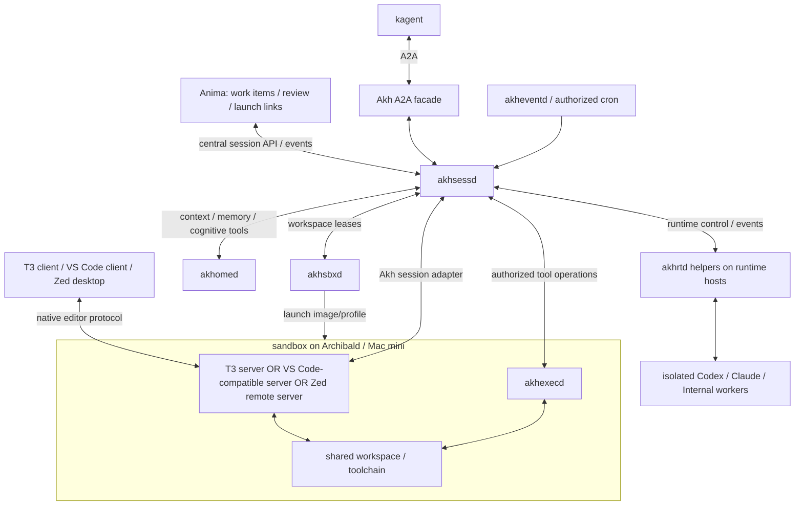

# Kubernetes, ACP over WebSocket, kagent and T3 Code deployment plan

Date: 2026-09-11. Status: researched proposal; no implementation or deployment.
Parent: [agent-loop map](../map.md). Previous design:
[daemon boundaries](daemon-boundaries.md).

## 1. Requirements and changes in direction

The user clarified that the deployment goal is Kubernetes at work and in the
homelab, alignment with ACP over WebSocket and kagent, sandboxed workspaces on
Archibald and the Mac mini, and runtimes placed on different machines. Helpers
manage those runtimes. The latest clarification requires unmodified upstream
external services: our helpers launch them, manage supported configuration and
login flows, and automate client connections. Sessions remain central in
`akhsessd`, with the selected T3, VS Code-compatible or Zed remote server beside
`akhexecd` inside a selectable sandbox image/profile. Anima should consume these
services and shed its own execution-routing layer. Separate Akh adapters may
use supported interfaces; mandatory T3 source changes are superseded.

This makes ACP/WSS the first client-to-agent integration target. AG-UI remains
an optional adapter for other applications; A2UI remains optional presentation
data. Neither is required for the first T3 deployment. ACP and kagent serve
different boundaries and can be used together.

Retain the chosen daemon names and one loop implementation fixed per Akh.
Runtime placement and workspace placement are independent bindings. Editor
server and executor placement are deliberately co-located. This supersedes the
earlier proposal for a central T3 server with custom remote filesystem/Git/PTY
adapters. Co-locating an agent runtime too remains a possible pilot profile;
it does not complete the separate-runtime-machine requirement.

The detailed ownership rules, transport profile and sequence below are
recommendations. This local plan has not changed Anima's native Plan or Work
Items. Research did not log into, change, or measure any running host/cluster.

## 2. Research findings and version boundaries

Primary sources were read on 2026-09-11, including source at exact commits.
[Source inventory](deployment-research-sources.json) records the inspected
upstream revisions and file hashes. A source checkout is not runtime evidence.

| Component | Inspected baseline | Finding and consequence |
| --- | --- | --- |
| ACP specification | [v1 transports](https://agentclientprotocol.com/protocol/v1/transports) | JSON-RPC and lifecycle are transport independent. The page still marks Streamable HTTP as draft and allows documented custom transports. Do not advertise one universally settled remote transport profile. |
| ACP SDKs | TypeScript `c88bb0da97fe1059d4e3032df2724bf39c96f3d2`; Rust `3a6d0ae88dbaa09fcb74e26761e3643a75b2015e` | Both have WebSocket support. Reuse a pinned SDK/profile; test interoperability with the selected clients. |
| kagent released | [v0.10.1](https://github.com/kagent-dev/kagent/releases/tag/v0.10.1), commit `a3d26eaf2eda002d9c9104d2a8f6f27a2ff23ec3` | Released tree has the v1alpha2 Agent/BYO API. This is the initial compatibility baseline, subject to the actual work-cluster version. |
| kagent development | `2d843e3732c308d7728c4c7daa1708a96277f159` | Main has v1alpha3 Harness/AgentTemplate APIs and native Codex/Claude harnesses absent from the inspected release tree. Treat them as a separate evaluation lane. |
| T3 Code released | [v0.0.40](https://github.com/pingdotgg/t3code/releases/tag/v0.0.40), commit `09e8de9c655ae85410bf6b00446f272a01da81c7` | ProviderDriver and AcpSessionRuntime seams exist in this release. |
| T3 Code development | `2ebc9fa4ed24e389eef24039f27c73ae6633858f` | The inspected ProviderDriver and AcpSessionRuntime files match the release versions. Other internals can change independently; pin the integration branch. |

### ACP over WebSocket

The [Rust transport implementation](https://github.com/agentclientprotocol/rust-sdk/blob/3a6d0ae88dbaa09fcb74e26761e3643a75b2015e/md/http-transport.md)
offers HTTP/SSE and WebSocket at `/acp`. The
[TypeScript example](https://github.com/agentclientprotocol/typescript-sdk/blob/c88bb0da97fe1059d4e3032df2724bf39c96f3d2/src/examples/ws-client.ts)
shows initialization, session creation, prompting and reconnect/load handling.
It explicitly leaves replay of messages lost during disconnection outside ACP
v1. The [Python SDK](https://agentclientprotocol.github.io/python-sdk/web-transport/)
still labels web transports experimental. SDK support and normative protocol
status must therefore be reported separately.

The local Akh crate currently uses `agent-client-protocol` 0.14.0 with its
Unix/TCP boundary. Adding WSS requires an adapter and compatibility work; the
newer upstream transport API is not assumed to drop into the current code.

### kagent integration and reuse

The [released Agent schema](https://github.com/kagent-dev/kagent/blob/a3d26eaf2eda002d9c9104d2a8f6f27a2ff23ec3/go/api/v1alpha2/agent_types.go)
describes BYO containers serving A2A. Its
[published API reference](https://kagent.dev/docs/kagent/resources/api-ref/)
specifies port 8080 for that interface. ACP/WSS exposure does not itself make
Akh a kagent BYO agent. We need an A2A facade with task/context mapping and
AgentCard support. Kubernetes can deploy that facade while Akh runtime workers
remain on other machines.

New [native harness source](https://github.com/kagent-dev/kagent/blob/2d843e3732c308d7728c4c7daa1708a96277f159/go/harness/README.md)
already separates configuration compilation, native drivers, continuation
storage and A2A task projection. Evaluate reuse before building equivalent
kagent-specific lifecycle machinery. This code is not part of the inspected
v0.10.1 release.

The development [Codex harness](https://github.com/kagent-dev/kagent/blob/2d843e3732c308d7728c4c7daa1708a96277f159/go/harness/codex/README.md)
supports native thread resume and selected MCP approval/input handling, but
uses Secret-backed API-provider configurations, does not advertise account
login, and relies on Substrate isolation with native `danger-full-access`.
It is not a substitute for our provider-owned subscription-login profile or
proof of exclusive remote `akhexecd` execution.

The development [Claude harness](https://github.com/kagent-dev/kagent/blob/2d843e3732c308d7728c4c7daa1708a96277f159/go/harness/claude/README.md)
supports native continuation and MCP approval. It lists gaps in user questions,
checkpoint/fork continuity and per-tool MCP selection. Its parked approval
example relies on an Actor memory snapshot preserving a live process and
channels; ordinary process restart plus a database row is not equivalent.

kagent Substrate/Harness APIs and Kubernetes SIGs
[Agent Sandbox](https://github.com/kubernetes-sigs/agent-sandbox) are separate
provisioning integrations. Do not combine their CRD fields or assume their
snapshot and isolation guarantees are interchangeable.

### T3 Code is an application server boundary

T3's [remote architecture](https://github.com/pingdotgg/t3code/blob/2ebc9fa4ed24e389eef24039f27c73ae6633858f/docs/internals/remote.md)
places a project and its threads in one environment. SSH, Tailscale and other
routes change how clients reach that environment; they do not automatically
move its execution to a second machine.

Its [architecture](https://github.com/pingdotgg/t3code/blob/2ebc9fa4ed24e389eef24039f27c73ae6633858f/docs/internals/overview.md)
uses its own client/server RPC over WebSocket. That protocol is different from
ACP over WebSocket. Preserve the browser-to-T3 boundary and evaluate a separate
agent bridge through supported upstream configuration or extension interfaces.

The [ProviderDriver](https://github.com/pingdotgg/t3code/blob/2ebc9fa4ed24e389eef24039f27c73ae6633858f/apps/server/src/provider/ProviderDriver.ts)
and [ProviderAdapter](https://github.com/pingdotgg/t3code/blob/2ebc9fa4ed24e389eef24039f27c73ae6633858f/apps/server/src/provider/Services/ProviderAdapter.ts)
show the required instance/account, session, turn, approval, question,
interruption and event behavior. These are internal source types, not evidence
of a public plugin loader. The inspected
[AcpSessionRuntime](https://github.com/pingdotgg/t3code/blob/2ebc9fa4ed24e389eef24039f27c73ae6633858f/apps/server/src/provider/acp/AcpSessionRuntime.ts)
requires spawn configuration and constructs a child-process ACP connection.
Merely setting a central WSS URL is not supported by this inspected seam.
The static built-in registry cannot register a new Akh driver from its name.
The existing Codex driver has configurable binary/home paths and launch
arguments; evaluate a separately shipped protocol bridge there, without assuming
it can accept ACP or expose full central-session behavior. The
[upstream-only attachment plan](upstream-services-tool-bindings.md#upstream-t3-attachment-feasibility)
records the evidence, required compatibility and unavailable-capability outcome.

Workspace functionality is separate: T3's
[WorkspaceFileSystem](https://github.com/pingdotgg/t3code/blob/2ebc9fa4ed24e389eef24039f27c73ae6633858f/apps/server/src/workspace/WorkspaceFileSystem.ts)
uses its server filesystem, and
[CheckpointStore](https://github.com/pingdotgg/t3code/blob/2ebc9fa4ed24e389eef24039f27c73ae6633858f/apps/server/src/checkpointing/CheckpointStore.ts)
delegates checkpoint operations through
[VcsDriver](https://github.com/pingdotgg/t3code/blob/2ebc9fa4ed24e389eef24039f27c73ae6633858f/apps/server/src/vcs/VcsDriver.ts).
Provider transport work alone cannot make file browsing, Git and terminals
operate on a sandbox located elsewhere.

The user's co-location choice resolves this by putting the T3 server in that
sandbox. Keep these upstream filesystem/Git/terminal implementations and point
them at the same workspace as `akhexecd`; a distributed T3 filesystem layer is
no longer a required integration deliverable.

### Editor-specific workspace endpoints

[Zed remote development](https://zed.dev/docs/remote-development) uses a local
desktop UI and a headless remote server over SSH. Its server binary must match
the connecting client version. A Zed image/profile therefore prepares the SSH
environment, toolchain and compatible remote-server installation/cache; it is
not a browser server or a generic ACP/WSS endpoint. The Akh ACP attachment is
a separate client integration, whose process location must be tested.

[OpenVSCode Server](https://github.com/gitpod-io/openvscode-server) is a candidate
for a self-hosted browser-editor image. Microsoft
[VS Code Server](https://code.visualstudio.com/docs/remote/vscode-server) is a
different distribution with its own single-user/service-use restrictions and
connection flow. Keep the selected distribution explicit in the profile rather
than treating the names as interchangeable. Shared deployments need explicit
authentication; do not carry an unauthenticated image default into production.

## 3. Proposed target topology

The Akh attachment arrow is a target capability: an external bridge uses an
editor's supported interface and may run in the sandbox or on the client.
Stock T3 central-session attachment is not yet verified. Provisioning an editor
endpoint and integrating its agent panel are separate checks.

Deployment roles, independent of where a particular Akh is homed:

| Location | Proposed services | Constraints |
| --- | --- | --- |
| Work or homelab Kubernetes | Central `akhsessd`, `akheventd`, `akhsbxd`, kagent/A2A facade; Anima and `akhomed` where appropriate | Distinct service identities and state owners; common Helm/GitOps structure with site overlays. Editor servers follow the sandbox placement. |
| Archibald | Image-selected sandbox containing editor server, `akhexecd` and toolchain; optional independent runtime capacity | Current GitOps tree describes Linux/k0s and existing Anima/Solstice consumers. Reserve capacity without taking over their workloads. |
| Mac mini | Host helper and selected native or VM sandbox backend; editor server and `akhexecd` inside the same target | Native macOS and Linux-in-VM are different capabilities. OCI Linux images do not make macOS a native Kubernetes worker. |
| Other runtime hosts | `akhrtd`, provider installation/authentication state and isolated workers | Provider account, version, runtime OS/architecture and execution posture constrain placement. |

The current infrastructure checkout contains Archibald runner/executor
deployment material under `/Users/toasty/ws/talos/clusters/archibald/`. It is
configuration evidence, not a fresh readiness/capacity witness. Its runner
README describes privileged shared DIND and explicitly does not claim strong
isolation. A new sandbox profile must state its actual boundary rather than
inherit a stronger claim from the word sandbox.

Work and homelab deploy the same contracts in separate trust domains. A shared
codebase is not an instruction to federate their credentials, events or
workspaces. Cross-domain access would need a separately configured route.

## 4. Central sessions and sandbox-local editor state

Use layered ownership to avoid two independent controllers of one provider:

| Record or action | Authority |
| --- | --- |
| Canonical session identity, lifecycle, transcript, admission, ordering, approvals and execution result | Central `akhsessd` |
| T3 environment/project/thread projection, editor settings and local UI state | Sandbox-local T3 server, bound to the central session |
| Editor/T3 attachment and workspace endpoint association | `akhsessd`, with client-specific adapter state |
| Provider-private continuation and process lifecycle | Selected runtime owner: `akhrtd` worker, or a delegated kagent runtime |
| Agent workspace operations, file-version checks and execution receipts | Bound `akhexecd`; editor operations share the workspace under the same access policy |
| Akh persona and durable cognitive memory | `akhomed` |

The central session outlives a browser tab or editor-server restart. T3's local
thread and environment records are required application state, not a competing
authority for agent lifecycle. Preserve or rebuild their mappings and event
projections from the central session through supported interfaces. A compatible
bridge must map T3 create/resume to central admission and existing bindings.
Until that path passes the upstream-only feasibility check, T3 exposes workspace
access and does not claim central agent attachment. The same distinction applies
to other editors; shared files alone do not synchronize their chat panels.

The launcher selects an authorized Akh and its declared capabilities. A supported
T3 binding must not let the provider picker silently override that Akh's fixed
loop or launch another provider for the centrally bound thread. Keep model
selection and loop selection distinct. Use upstream command/endpoint/extension
interfaces; do not patch driver registration, settings schemas or UI bundles.
If an interface is missing, record the upstream feature requirement and leave
that capability unavailable, rather than reporting a partial bridge as complete.

Persist identifiers separately: T3 environment, project and thread IDs; Akh
session and turn IDs; provider/account/runtime binding; sandbox/workspace
binding; optional A2A context/task IDs. Scope mappings by authenticated
principal and environment. Never equate IDs merely because they are strings.

For kagent, an A2A context maps to an authorized conversation and each task to
an admitted attempt. A task can stop for input and continue; it is not always
one prompt call. Map supported approval/question states explicitly. A2A does
not automatically expose every ACP terminal or interactive UI feature.

The Akh session owner admits one active turn by default. A T3 attachment may
control it while other clients observe. Automation targeting the same session
queues under that owner. If an automation should appear in T3, use a durable
connector to create/bind a thread and project its events; a failed projection
must not rerun the automation. Anima retains its work-item scheduling owner;
central services own runtime/executor placement and session command delivery.

## 5. Transport contracts

### ACP/WSS boundary

Use the upstream WebSocket message transport, with an explicit tested profile:
authentication before authorized session operations; initialize and capability
negotiation; JSON-RPC framing; bounded messages and queues; bidirectional
callbacks; cancellation; keepalive and connection-close behavior. Preserve
standard ACP methods, and document any `_akh/*` extensions separately.

Network authentication and session authorization are different checks. T3 can
use server-side credentials scoped to the user/tenant delegation. A direct
browser client needs a supported browser auth flow and origin validation;
avoid credentials in ordinary URL query strings. K8s ingress/gateway tests must
exercise WebSocket upgrade, idle timeouts and draining, not just HTTP health.

Persist accepted commands before dispatch. Give mutations application-level
idempotency keys; reconnect must query acceptance/outcome instead of replaying
a prompt blindly. A session journal supplies an ordered cursor and snapshot
for T3 projections. Treat reconnect, session load, event catch-up and pending
approval recovery as separate steps. Raw JSON-RPC request IDs are hop-local;
do not replay an old approval response into a new provider request.

### Service APIs and the shared local workspace

Do not force provisioning, binary file transfer or PTY traffic into ACP. Use
versioned typed service contracts over authenticated IPC/network streams.
ACP client filesystem/terminal callbacks and Akh tool calls both resolve to
the same authorized workspace binding when that profile is enabled.

`WorkspaceBinding` should carry an opaque workspace ID, site/target, executor
identity, lease generation, platform, capabilities and executor-resolved root.
Clients use relative paths plus that binding. Central services must not run
local `canonicalize()` against an Archibald or macOS path.

Editor file/search/Git/PTY operations use their native server implementations
against the shared local workspace. `akhexecd` still exposes the remote agent
tool interface, with file versions, execution receipts and cancellation/status.
There is no central T3 filesystem proxy in the preferred design. An image may
run both services in one container or coordinated containers sharing the same
sandbox filesystem, identity/permissions and workspace mount.

Co-location does not serialize mutations. Coordinate destructive operations
and checkpoints with a workspace lease/quiescence boundary; use file version
checks where practical and detect conflicts with editor saves or terminals.
T3 keeps its native checkpoint implementation, but a combined conversation/file
revert still requires both capabilities before changing files. Agent operations
through `akhexecd` have agent receipts; editor/native-terminal writes do not
automatically become such receipts. Do not claim all workspace activity passes
through `akhexecd` just because it shares a sandbox with the editor.

Attachments uploaded to the sandbox-local T3 server must become authorized
artifact references for a runtime on another host. Sending that runtime an
absolute local pathname is insufficient. Preserve this small integration seam
even though ordinary file browsing no longer needs a remote adapter.

## 6. Runtime helpers and independent placement

`akhrtd` is the host runtime helper/supervisor. Its narrow management contract
covers registration, capabilities, capacity, installation inventory, health,
version preparation, start/resume, drain and stop. These are deterministic
operations; another autonomous LLM is not required to manage the loop.

Publish a `RuntimeDescriptor` with host/site, OS/architecture, provider kind,
installed revision, authentication-profile reference/status, execution modes,
available capacity, reachability and a heartbeat/ownership generation.
Health probes should not create billable sessions, trigger login or run tools.
Keep provider credentials at the provider's authorized location.

Install new versions alongside active ones and bind new sessions to a revision.
Drain old workers before removing their executable/state. Startup after a
partition requires ownership reconciliation; heartbeats alone do not revoke a
worker's authority. Loss of connectivity leaves command outcomes unknown until
queried or fenced, rather than immediately creating another worker.

Runtime and executor placement requires a capability matrix:

| Mode | Meaning | Admission |
| --- | --- | --- |
| Runtime and workspace co-located in an isolated environment | Native provider tools see the intended files | Useful pilot mode; native activity still differs from `akhexecd` receipts. |
| Runtime host differs from workspace host; all workspace operations brokered | Provider native reads/writes/commands cannot bypass the bound executor | Required target mode for the user's separate-machine topology; conformance gate per provider. |
| Runtime uses a staged snapshot and returns a patch | Explicit offline/staged workflow with conflict handling | Optional future mode; does not provide a live shared workspace. |

Both current Akh provider adapters permit native local operations and reject
non-in-process executor configurations. Preserve that guard until remote
execution behavior, including native reads, hooks, plugins and subagents, is
proved. If a provider cannot meet the remote mode, report that provider/profile
as unsupported and retain the target as an open delivery requirement.

For a kagent-owned runtime, `akhrtd` delegates lifecycle through a backend
adapter; it does not also spawn a competing Codex/Claude process for the same
session. Retain existing Akh adapters for externally managed machines and
supported provider-login profiles. Select the backend once per binding.

## 7. kagent and sandbox ownership

Initial integration: deploy a small Akh A2A facade using the released BYO
contract. It translates to `akhsessd`, which routes to the chosen runtime and
workspace. The facade is a transport adapter, with no new agent loop or private
conversation history. A stable A2A task/context mapping belongs in the session
ledger. Validate cancellation, input-required, retries and artifacts end to end.

`akhomed`, `akhsessd` and other supporting daemons remain normal Kubernetes
workloads. kagent's BYO controller need only own its adapter deployment and
registration. Do not wrap every daemon in a declarative LLM agent.

Evaluate the new native harnesses separately against exact source/images,
provider authentication, native tool policy, approval durability and snapshot
storage requirements. Do not copy v1alpha3 Harness manifests into a v0.10.1
installation. The migration of CRDs/controller/chart/runtime must be coordinated.

`akhsbxd` owns our workspace leases and invokes a selected provisioner driver.
The driver can use Kubernetes Agent Sandbox or a host-managed sandbox/VM
service. If a future kagent backend owns a runtime Actor, reference that Actor;
do not run a second reconciler that independently deletes/replaces it. Runtime
Actor lifetime and a remote workspace lease need not match.

The Mac mini driver must distinguish Linux-in-VM work from native macOS work.
The Archibald driver must coexist with existing KVM/build capacity owners.
Profile selection includes toolchain, storage quota, retention, network access
and isolation posture. Advertise readiness only after both provisioner status
and an authenticated executor handshake succeed.

## 8. Implementation slices and acceptance

The order below starts with the integration risks. Local documentation does
not create tracker dispatch or authorize a production rollout.

| Slice | Deliverable and likely ownership | Evidence required |
| --- | --- | --- |
| D0: pin deployment baseline | Versions and image-profile matrix; work/homelab overlays; exact Archibald and Mac sandbox APIs | Target versions, host platforms, capacity, editor distribution and reachable endpoints recorded without credentials. |
| D1: session and workspace contracts | Small shared contracts crate; T3 binding schema; explicit input origin and durable IDs | Duplicate admission produces one turn; two clients cannot obtain conflicting controller ownership; stale generations rejected. |
| D2: ACP/WSS and upstream T3 attachment | `akhsessd` transport extraction; supported-interface feasibility check and separate bridge if adequate; no T3 source modifications | Unmodified upstream T3 creates a thread, prompts, streams, answers approval/question, cancels and reconnects to the same central session. If the interface is insufficient, record the missing upstream capability; a running editor alone does not pass D2. |
| D3: selectable editor sandbox images and client connection helper | `akhexecd` plus upstream editor profiles, shared mount and endpoint descriptors; small per-user helper registers the bootstrapped T3 environment through supported pairing | Launch chosen image and connect from the user's machine; retries do not duplicate environments; endpoint changes retain identity; editor and executor share the file/Git tree; client disconnect leaves the prestarted server alive. |
| D4: runtime and service helpers | `akhrtd` and Codex/Claude adapter extraction; shared profile/config/login library also used by sandbox helpers; registration, revision leases and drain | Atomic managed-config updates preserve user state; scoped supported login and exact native resume survive restart; no replacement session or local-executor fallback. |
| D5: independent runtime placement | Provider-specific semantic tool bindings, native-tool restrictions and remote-workspace profile | Runtime on host A edits/tests through executor on host B; native denial and successful supplied-tool calls, including alias/deny interactions, prove location and semantics with receipts. Exercise both named workspace sites. |
| D6: released kagent integration | A2A facade/BYO image, AgentCard, task/context mapping and Helm configuration | kagent invokes the same Akh service, receives progress, pauses for input, continues/cancels and returns accepted artifacts; retries do not duplicate turns. |
| D7: provisioning and events | `akhsbxd` drivers; `akheventd` RabbitMQ/webhook/Djehuty and CronJob integration | Sandbox allocation/retention/cleanup, duplicate triggers, incident/thread reuse, failed-delivery recovery and T3 projection all preserve one execution owner. |
| D8: operations and promotion | Site overlays, backups, observability, disruption behavior and rollback compatibility | Restart each owner independently; recover pending input; drain rolling upgrades; reject cross-user/site attachment; restore state and reconcile retained workspaces. |
| D9: simplify Anima routing | Thin session-service adapter, durable work-item/session mapping and event projection; retire legacy routing per migrated lane | No dual dispatch, exact-revision completion/review gates preserved, existing sessions drained or explicitly migrated, Anima restart does not kill central sessions. |

D2 and D6 can begin with a deterministic test agent. D3 can start with a
manually allocated image/profile before automatic provisioning. D4 and D5 preserve
and extend the current provider fixture tests. D7 can then replace manual
allocation. The optional kagent development-harness evaluation can inform D4
without making the initial released integration depend on that evaluation.

Before committing to full extraction, run two bounded feasibility spikes:
one unmodified sandbox-local T3 server bound through a supported interface to a
central session, and the D5 native-tool restriction/broker path for one provider.
Keep those experiments independent. For the latter, place a canary file
only on the executor, deny workspace access on the runtime host, attempt
native reads/writes/commands and inherited hooks/subagents, then require a real
brokered edit and test run with receipts. An instruction saying to prefer MCP
does not satisfy the experiment. These spikes validate the hardest assumptions
early; they are not permission to remove the existing production guard.

The first useful vertical slice is Anima/central launcher -> a selected T3
sandbox on Archibald -> one central Akh session over ACP/WSS, with T3 and
`akhexecd` observing the same local files/Git/terminal effects. Then exercise
Zed and the VS Code-compatible profile, repeat on the Mac mini, and prove
separate runtime placement. Editor/executor co-location is the target;
runtime/executor co-location is intermediate until D5 passes.

## 9. Deployment and operational details

Start with one active T3 server for each allocated T3 sandbox/environment and
one central logical owner per Akh session, with durable state. Do not assume current
[SQLite-backed T3 state](https://github.com/pingdotgg/t3code/blob/2ebc9fa4ed24e389eef24039f27c73ae6633858f/apps/server/src/persistence/Layers/Sqlite.ts)
supports active-active replicas by sharing a filesystem. Preserve the local
T3 database/environment ID on an application-state volume or implement explicit
rehydration/mapping. Rebuilding an image must not silently create a new central
session. A different editor image can attach to the retained workspace after a
controlled handover, with its own application state and the same central session.

Use per-service identities, network routes and quotas. Prefer a site-local
helper connection over the private network; when inbound connectivity is not
available, a scoped outbound control channel can carry typed commands. Do not
use an unrestricted reverse shell as the management protocol. A tunnel supplies
reachability, not session authority or a shared filesystem.

Observe the full chain using trace/correlation IDs: T3 command, Akh turn, kagent
task, runtime worker, sandbox lease and executor operation. Record queue delay,
capacity, heartbeat age, approval wait, stream lag and final operation status.
Provider/tool payload logging must follow the same data-access policy as the
session; identity and status metrics usually do not need raw prompts.

Keep application state, provider-private continuation, workspace data and
ephemeral sandbox state in separate retention classes. Session recovery must
reconcile all relevant bindings before admitting another turn. A healthy pod,
an open WebSocket, provider completion and a verified workspace result are
different observations.

## 10. Outstanding facts before implementation

- The work-cluster kagent version and whether work intends to adopt the
  v1alpha3/Substrate generation or the released BYO generation.
- The concrete Mac mini sandbox API and which tasks require native macOS.
- Which runtime machines/accounts are eligible for work versus homelab data.
- A supported upstream T3 central-session attachment/rehydration seam and editor
  launch authentication; validate a separate bridge, without source patches.
- Which provider can satisfy exclusive remote execution first. Existing source
  establishes a limitation, not a successful remote execution profile.

These do not block the researched architecture. They are entry criteria for
the corresponding implementation slices. Documentation checks cover links,
source inventory and examples only; no provider session, cluster deployment or
cross-machine execution was run for this plan.

## 11. Image profiles, allocation and Anima simplification

See [sandbox images and Anima routing migration](sandbox-images-anima.md) for
the image contract, launch/attach flow, source-level routing trace and cutover
requirements. It records the user's co-location clarification and supersedes
the earlier central-T3/remote-filesystem integration proposal.

See [upstream services and tool bindings](upstream-services-tool-bindings.md)
for the latest upstream-only constraint, shared service/config/login profiles,
supported connection automation and semantic runtime-tool substitution. It
refines D0/D2/D3/D4/D5 and removes mandatory upstream source modifications.
Its [machine-local helper](upstream-services-tool-bindings.md#machine-local-environment-connection-helper)
implements the user's requested post-bootstrap T3 environment onboarding.
