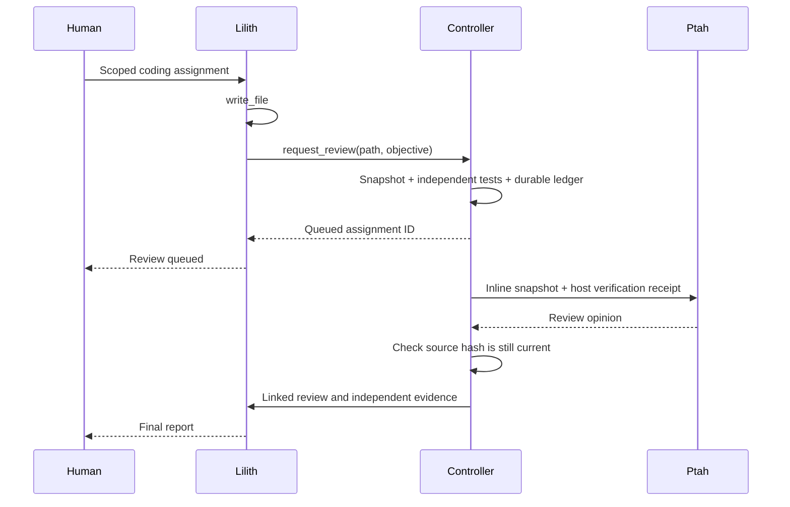

# Lilith local coordination slices

This is a bounded local development controller: Lilith writes an artifact under
an operator-selected contract, asks Ptah for review through a real client-tool
call, and later summarizes the returned review to the human. The host independently
verifies the artifact. Contracts cover local Python reference fixtures. A second,
separate repository-task controller exercises a fixed one-file replacement in a
disposable repository copy, a fixed host test command, and sequential Khnum and
Ptah specialist turns. It is still not general patch execution or native illumos
validation.

## Two-specialist repository task slice

`lilith_repository_coordination.py` admits one operator-fixed target basename and
one operator-fixed test command. Khnum returns a complete JSON replacement for
that file. Production coordination refuses to execute the proposal unless an
executor is explicitly configured. The CPU regression fixture has a deliberately
narrow executor: it accepts one undecorated, expression-only Python function,
copies a fully snapshotted repository with no links or special files, applies the
replacement there, and runs a resource-limited fixed command with bounded output.
The VM-backed runner will use an SSH guest executor instead. Only a passing
proposal reaches Ptah. The original checkout is not modified.

The durable assignment records the original source hash, test inventory, proposed
replacement, process exit code and bounded stdout/stderr, reviewer opinion, and
human-facing report. The completion prompt explicitly distinguishes local process
tests from reviewer opinion and forbids claims that the source repository was
changed or that model/native validation occurred.

An operator correction increments an immutable revision, cancels and observes
all admitted patch, review and report turns, clears stale evidence, and
redispatches every stage with fresh revision-bound idempotency identities. Operator
cancellation uses the existing ledger mailbox and cancels only admitted patch,
review and return turns. A failed specialist, malformed/wrong-path proposal,
failed test command, empty review, or failed report cannot become completion.
Timeouts become durable failed receipts and stdout/stderr are bounded. The
executable fixture uses synthetic API peers and a strictly bounded local fixture
process; it makes no claim about Lilith, Khnum, or Ptah model behavior.

## Flow



The controller waits for the author turn to complete before admitting child work.
This prevents a nested model request from blocking on the same resident-model
runtime. Ptah uses a dedicated `ptah-inline-reviewer` identity with no tools, backed by
the same Ptah runtime profile. The existing `ptah-validator` identity retains
its read-only tools for file-based reviews. The reviewer receives an inline
snapshot; `author_path` labels its origin and is not a reviewer workspace path.

The existing session daemon owns sessions, turns, decisions, provider bindings,
and broker receipts. `lilith_coordination.py` adds an assignment ledger, using
stable request IDs at those API boundaries instead of a second dispatch protocol.
It uses the dedicated local operator credential, not the Anima database. The
SQLite ledger is private project state outside all model-visible workspaces.

## Run the local fixture

The prepared Vulkan stack has the `request_review` grant. For a new stack, add
`--coordination` to `prepare-lilith.py` together with `--ptah-config`. Without a
controller, a request to that client tool remains pending; no review is implied.

From the repository root, choose a fresh output directory:

```sh
AKH_VULKAN_PIPELINE_CACHE_ENTRIES=16384 \
VK_DRIVER_FILES=/usr/share/vulkan/icd.d/radeon_icd.x86_64.json \
python3 scripts/session-platform/lilith-review-smoke.py \
  --root "$HOME/.local/share/akh-medu/lilith-dev-vulkan-20260921" \
  --coordinate --turn-timeout 360 \
  --output training/lilith/coordination-new-run
```

The fixture owns and stops its four project daemons. It records the real model
request, successful tool receipts, 2,051 independent integer cases, linked child
session/turn, final report, and same-process model switching. It recreates its
controller from the persistent ledger after the authoring turn. It does not
simulate a daemon crash or claim full distributed recovery certification.

## Inspect or resume an assignment

The fixture prints `session_id` and `turn_id` in its `coordination_scope` event.
Status works while the writer is active and after the services have stopped:

```sh
python3 scripts/session-platform/lilith_coordination.py \
  --root "$HOME/.local/share/akh-medu/lilith-dev-vulkan-20260921" \
  --session SESSION_ID --turn AUTHOR_TURN_ID --status
```

To resume, run the same command without `--status` after starting the project
services. Use `--once` for one reconciliation tick. Only one writer may own the
ledger; an existing controller must exit before another resumes it. The deadline
stops the controller, preserving pending work for inspection/resumption; it does
not silently cancel an in-flight runtime job.

## Select an artifact contract

| Contract | Artifact | Host checks |
|---|---|---|
| `integer-clamp/1` (default) | `clamp_u8.py` | 2,051 integer cases |
| `u64-range/1` | `range_within_u64.py` | 2,926 unsigned-range and dense small-range cases |

Lilith now has a 512-token output cap to accommodate the longer source/tool
envelope; Ptah retains its supplied limits.

For the second fixture, add `--contract u64-range/1` to the `--coordinate` smoke
command above. Use the same `--contract` when resuming its controller. Status and
cancellation commands do not need it because they address an existing assignment.
A newly prepared coordination stack grants both artifact names; the operator's
selected contract still restricts each controller to exactly one artifact. A
model cannot choose a different verifier by requesting another granted filename.

Each new assignment and verification receipt includes the contract ID, artifact,
specification and verifier-module SHA-256. A changed verifier/specification is
rejected on resume rather than silently reinterpreting existing evidence. Preserve
the original verifier to resume, or cancel the old assignment and start a fresh
one with the new contract. Legacy clamp rows remain readable; their older receipts
do not acquire retroactive implementation provenance.

The range contract checks whether an unsigned 64-bit `(start, length)` range fits
within `limit`, including empty ranges at the boundary, negative inputs and values
above UINT64_MAX. Its independent oracle uses Python's unbounded arithmetic.
Generated code is restricted by a small AST allowlist before execution: no calls,
imports, loops, attributes, multiplication or exponentiation. Failing checks give
a concrete counterexample; equivalent correct implementations are accepted.

These tests establish the Python reference behavior for sampled cases. They do
not establish C integer promotion/overflow behavior, ABI compatibility, kernel
safety, native illumos behavior, or benchmark parity. The next native verifier can
use the versioned receipt boundary once illumos VMs are available.

## Cancel an assignment

The operator can write a durable cancellation request while the controller holds
its writer lock, or while project services are stopped:

```sh
python3 scripts/session-platform/lilith_coordination.py \
  --root "$HOME/.local/share/akh-medu/lilith-dev-vulkan-20260921" \
  --session SESSION_ID --turn AUTHOR_TURN_ID \
  --cancel ASSIGNMENT_ID --reason "Stop this assignment"
```

This command records intent; it does not claim that execution has stopped.
A running or resumed controller handles it. `--status` exposes the request
immediately. The immutable request is scoped to an existing assignment and its
parent turn. Repeating the same reason is idempotent; changing it is rejected.
Already completed outcomes cannot be retroactively cancelled. An `unknown`
outcome can still request cancellation because its runtime may be active.

The controller enters `cancelling`, reconciles already-persisted outbound
requests, and cancels only its author, review and report turns. Unrelated turns
are untouched. It waits for each owned turn to be completed, failed or cancelled;
`cancel_requested` and `unknown` do not confirm termination. A completion that
races with cancellation remains visible in the cancellation observations, while
the assignment outcome is cancelled. A request committed before the local
completion transaction wins over completion.

After a lost submission response, replaying the saved request can admit a turn
whose original delivery was uncertain. The controller immediately cancels that
recovered turn; it never invents an unpersisted review/report request. Therefore
cancellation is cooperative, not rollback or a guarantee of zero additional
execution. Native model preparation now reports confirmed cancellation at safe boundaries.
Later generation/callback uncertainty can still require audited runtime recovery.
No force-cancel timeout is used. The controller's own deadline leaves
unconfirmed cancellation resumable and visible.

An author cancellation/retirement or changed artifact also stops owned work.
A stale artifact becomes terminal `stale` only after owned turns settle. The
fixture remains limited to the selected local contract and one specialist.

## Evidence and failure behavior

An assignment records its immutable request, source snapshot/hash, host-verifier
receipt, acknowledged input decision, reviewer session/turn, returned opinion,
and final parent turn. One admitted review per assigned author turn bounds fan-out.
Later model turns cannot acquire delegation authority through this controller.

Acknowledgements use the session service's durable input-decision endpoint.
A lost response is reconciled with the same request ID, even when the pending
input has disappeared. Child creation, review submission and return submission
also replay immutable request IDs. Tests inject response loss after each remote
commit and reopen the ledger, checking that no duplicate work appears.

Changed, removed or symlinked artifacts cannot receive a current completion.
Cancelled authors, rejected decisions, failed/unknown reviews, and empty final
reports cannot become successful assignments. Failure states remain visible;
automatic repair/replanning is not implemented. Running child/report cancellation
is supported through the durable operator mailbox and automatic scope checks.

The verifier's receipt records this host fixture's checks for the recorded
source hash. It does not prove reviewer correctness, arbitrary program safety,
benchmark parity, or native illumos behavior. Reviewer text is retained separately
as an opinion; only replay-verified source and curated principles can teach.

Recorded local results, handoff failures and recovery-test evidence are in
[the coordination report](../../training/lilith/coordination-20260921/README.md).

[Cancellation integration and recovery results](../../training/lilith/cancellation-20260921/README.md)
cover the second slice.

[Artifact-contract results](../../training/lilith/contracts-20260921/README.md)
cover the third slice.

## Optional learning after completion

Add `--lesson-db PATH` when running or resuming `lilith_coordination.py` to admit
successful work under the registered teaching contracts. `--status` includes a
separate `learning` receipt: admitted, rejected or revoked. A learning rejection
does not change a completed coding outcome, but normal completion exits
unsuccessfully unless every selected assignment also has an active admission.
`--once` reports whether a reconciliation tick ran; inspect its learning status
for the admission outcome.

The store UUID prevents a receipt from silently carrying over to a different
store. Replay after a lost store acknowledgement is idempotent; later revocation
is reflected on reconciliation. Storage failures leave admission resumable.
See [apprenticeship](APPRENTICESHIP.md) for provenance, limits and commands.

## Next slices

1. Connect the repository-task controller to a prepared model stack and capture
   actual specialist outputs without weakening its fixed target/test boundary.
2. Extend verified lesson admission beyond the two current teaching contracts.
3. Replace the local fixture verifier with isolated illumos VM validation when the
   host is ready, retaining the same assignment/evidence boundary.
