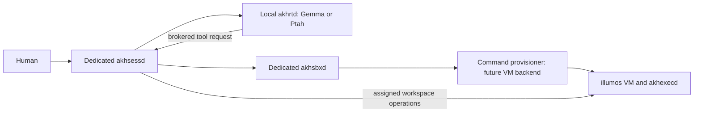

# Independent Lilith development stack

The session daemon owns Lilith and a separate `ptah-validator` identity. One local
`akhrtd` serves both Gemma and the existing Ptah model, one at a time. `akhsbxd`
owns workspace allocation; an executor provides workspace operations. Native
illumos validation is deferred until the host is ready, using VMs on hephaistos.



Preparation is implemented by `scripts/session-platform/prepare-lilith.py`. It
creates a new private directory, fresh per-service credentials and incoming
credential hashes, loopback-only service configs, isolated state, and bounded
model profiles. It refuses an existing root. It neither starts services nor
provisions VMs, and never reads the normal akhomed configuration.

```sh
python3 scripts/session-platform/prepare-lilith.py \
  --root "$HOME/.local/share/akh-medu/lilith-dev-vulkan-20260921" \
  --model "$HOME/.local/share/akh-medu/models/llm/gemma4-12b.gguf" \
  --tokenizer "$HOME/.local/share/akh-medu/models/llm/gemma4-12b.tokenizer.json" \
  --device vulkan \
  --ptah-config examples/native-ptah/akhrtd.json
```

The dated root above has already been prepared on hephaistos. For a fresh stack,
choose a new root and unoccupied four-port range with `--base-port`. Credentials
stay outside the repository. Configurations passed the four binaries' `--check`
commands; that check does not prove model or endpoint connectivity.

The initial `local-dev` profile grants only read/write within its allocated host
workspace. Ptah has read-only review tools. This is preparation for coding/tool
integration, not the full coding tool catalog or VM confinement. `allow_granted`
implements autonomous execution of these explicitly assigned capabilities.

## Model residency and review

`internal_native.rs` owns a process-wide mutex and resident model identity. A
different identity unloads the old model and releases unused GPU allocations
before loading the next. Both runtime profiles therefore live in **one akhrtd
process**. Do not run two copies against the GPU. Switching can require cold
prefill; measure and budget that cost, and batch work by model where useful.

Build the services with both native backends; the generated Lilith device is
selected with `--device vulkan` while Ptah retains its own HIP setting:

```sh
cargo build --release --locked -p akh-session-services --no-default-features \
  --features session,executor,sandbox,hip,vulkan \
  --bin akhsessd --bin akhsbxd --bin akhexecd --bin akhrtd
```

Export the settings in the generated `runtime.env` when launching `akhrtd`:
`AKH_GPU_MATMUL=0`, `AKH_GPU_QUANT=0`, and for Vulkan
`AKH_VULKAN_PIPELINE_CACHE_ENTRIES=16384`. The daemon does not automatically
source this file.
The older CPU matmul offload flag caused the startup timeout. Gemma now restricts
that offload to CPU-backed models, and routes Vulkan RMSNorm, rotary embedding
and softmax to supported device operations. Hardware regression tests compare
these operations against CPU results. The configuration check alone does not
establish model quality or successful model switching.

Ptah is a reviewer and comparison candidate, not the final correctness oracle.
Give its separate session an explicit artifact/evidence handoff. Tests, hidden
verifiers and final-state checks decide executable correctness. Never let a model
grade its own reference answers. Keep reference task solutions out of Lilith's
memory and training. The discovered Ptah tokenizer provenance names
`JonathanColetti/Qwen3.8-27B-Uncensored`; label this derivative exactly rather
than claiming an unmodified upstream Qwen comparison. Its model and tokenizer
hashes were verified during preparation.

## VM provisioner boundary

Use the existing `Provisioner::Command` interface in
`crates/akh-session-services/src/sandbox.rs`; no new daemon protocol is needed.
The backend must accept JSON on stdin and emit one JSON response on stdout:

- Acquire input: `operation`, `allocation_id`, `session_id`, `principal`,
  `profile`, `revision`.
- Acquire output (`WorkspaceBinding`): `id`, `sandbox_id`, `executor`,
  `generation`, `site`, `root`, `platform`, `confinement`. The first two IDs must
  match the requested allocation and `generation` must be 1. The remote root is
  interpreted by the guest executor, not canonicalized on the inference host.
- Release input: `operation`, `allocation_id`, `session_id`; emit a JSON result
  only after the owned allocation is released.

The returned executor key must be configured on the sandbox and session services.
Use a configured endpoint with allocation routing (`{sandbox}` is supported) or
an explicit guest endpoint registry; do not let model output invent endpoints.
Guest tokens and TLS/private-network policy must be scoped to the project.

The command runner clears its environment, supplies a minimal PATH, caps JSON at
1 MiB, and has a 120-second deadline. A VM adapter should allocate from prepared
images/clones, persist ownership keyed by allocation ID, and support reconciliation
after unknown outcomes. It must never blindly recreate a VM after a timeout or
delete a VM it does not own. Allocate a fresh snapshot/clone per evaluation and
keep hidden verifiers outside model-visible guest paths.

No VM profile is granted in the generated stack yet. Host preparation must pin
the illumos image, guest executor artifact, network, resource limits, snapshot
method and readiness behavior before that profile is enabled. Linux KVM, QEMU,
virsh and virt-install are present locally; VM readiness remains untested.

## Repeat the local preparation checks

```sh
python3 scripts/session-platform/test_prepare_lilith.py
python3 scripts/session-platform/check-lilith.py \
  --root "$HOME/.local/share/akh-medu/lilith-dev-vulkan-20260921" \
  --output training/lilith/startup-20260921/stack-health.json
```

The second command checks all configs, briefly starts only these project services,
checks `/healthz` identities, and stops its own processes. It refuses occupied
ports and submits no model jobs or VM allocations. All four services passed on
2026-09-21. The services are prepared and stopped, not installed as auto-start units.

## Exercise code creation and review

```sh
AKH_VULKAN_PIPELINE_CACHE_ENTRIES=16384 \
VK_DRIVER_FILES=/usr/share/vulkan/icd.d/radeon_icd.x86_64.json \
python3 scripts/session-platform/lilith-review-smoke.py \
  --root "$HOME/.local/share/akh-medu/lilith-dev-vulkan-20260921" \
  --output training/lilith/review-new-run
```

Use a fresh output directory. This starts and stops the project's four daemons,
asks Lilith to write a small integer-clamping function, verifies it independently
over 2,051 inputs, copies the artifact and evidence into Ptah's separate review
workspace, and asks Ptah to read and review it. It then returns to Lilith and
checks remembered session context and model unload/load records in the same
runtime process. Tool receipts and per-turn state are retained. Ptah's opinion
is not the executable test verdict. This fixture does not measure coding quality,
VSA learning, full autonomous delegation, or native illumos behavior.

The 2026-09-21 run passed this workflow with Gemma on Vulkan and Ptah on HIP;
[results and diagnosed failures](../../training/lilith/vulkan-20260921/README.md)
include numerical parity, tested artifact, review receipts and session continuity.
The corrected Vulkan stack is prepared and stopped. The older
`lilith-dev-20260921` root is preserved for diagnosis; it shares the port range,
so do not run it alongside this stack.

The Vulkan shader cache setting improved local warm Gemma decode by 12.7–16.7%
in counterbalanced coding-prompt measurements with identical outputs. See
[throughput evidence](../../training/lilith/vulkan-tps-20260921/README.md).
It changes cache residency, not model precision. The global default remains
2,048 entries; the application-held source-text budget stays 16 MiB, and explicit
entry overrides are capped at 16,384. Cold loading and unseen-shape compilation
remain separate costs.

The [durable review coordination workflow](COORDINATION.md) now supports live status,
controller resumption, cancellation, and versioned artifact contracts. Use
`--coordinate`; add `--contract u64-range/1` for the unsigned-range fixture.

The first [frozen-weight apprenticeship slice](APPRENTICESHIP.md) admits verified
lessons, tests text/VSA retrieval, and exports candidate training examples.
